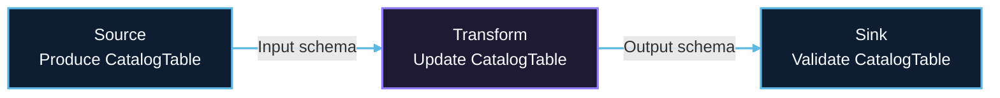

# CatalogTable and Metadata Management

## 1. Overview

### 1.1 Problem Background

Data integration requires explicit schema management:

- **Schema Definition**: How to define and validate table schemas?
- **Schema Propagation**: How to pass schema through Source → Transform → Sink?
- **Schema Evolution**: How to handle runtime DDL changes (ADD/DROP columns)?
- **Type Mapping**: How to map types between different data sources?
- **Metadata Completeness**: How to capture complete table metadata (constraints, partitions)?

### 1.2 Design Goals

SeaTunnel's metadata management aims to:

1. **Type Safety**: Explicit schema validation at job submission
2. **Completeness**: Capture all table metadata (columns, constraints, partitions, options)
3. **Evolution Support**: Handle runtime schema changes (DDL synchronization)
4. **Engine Independence**: Schema representation independent of execution engine
5. **Ease of Use**: Simple API for schema creation and transformation

## 2. Core Concepts

### 2.1 CatalogTable

Complete representation of a table with all metadata.

```java
public class CatalogTable implements Serializable {
    // Table identifier
    private final TableIdentifier tableId;

    // Schema definition
    private final TableSchema tableSchema;

    // Table options (connector-specific configuration)
    private final Map<String, String> options;

    // Partition keys
    private final List<String> partitionKeys;

    // Comment
    private final String comment;

    // Catalog name
    private final String catalogName;
}
```

**Key Components**:
- `TableIdentifier`: Unique table identity (`catalog.database[.schema].table`)
- `TableSchema`: Schema with columns, primary key, constraints
- `options`: Connector-specific settings (e.g., Kafka topic, JDBC table name)
- `partitionKeys`: Partition columns for partitioned tables

### 2.2 TableSchema

Schema definition with columns and constraints.

```java
public class TableSchema implements Serializable {
    // Column definitions
    private final List<Column> columns;

    // Primary key
    private final PrimaryKey primaryKey;

    // Unique/foreign key constraints
    private final List<ConstraintKey> constraintKeys;
}
```

### 2.3 Column

Column definition with type and constraints. `Column` is abstract; regular table columns are
`PhysicalColumn` instances (`MetadataColumn` is the other subclass).

```java
public abstract class Column implements Serializable {
    protected final String name;
    protected final SeaTunnelDataType<?> dataType;

    // Length / scale of the column, e.g. VARCHAR(255) or DECIMAL(10, 2)
    protected final Long columnLength;
    protected final Integer scale;

    // Constraints
    protected final boolean nullable;
    protected final Object defaultValue;

    protected final String comment;

    // Original type in the source system, e.g. "varchar(255)"
    protected final String sourceType;

    // Column options
    protected final Map<String, Object> options;
}
```

### 2.4 SeaTunnelDataType

Unified type system across connectors. Types are constants or classes in the
`org.apache.seatunnel.api.table.type` package (there is no `DataTypes` factory class).

**Basic Types**:
```java
// Numeric
BasicType.BYTE_TYPE      // TINYINT
BasicType.SHORT_TYPE     // SMALLINT
BasicType.INT_TYPE       // INT
BasicType.LONG_TYPE      // BIGINT
BasicType.FLOAT_TYPE     // FLOAT
BasicType.DOUBLE_TYPE    // DOUBLE
new DecimalType(precision, scale)

// String (CHAR/VARCHAR length is kept in Column#columnLength, not in the type)
BasicType.STRING_TYPE

// Binary
PrimitiveByteArrayType.INSTANCE

// Date/Time
LocalTimeType.LOCAL_DATE_TYPE        // DATE
LocalTimeType.LOCAL_TIME_TYPE        // TIME
LocalTimeType.LOCAL_DATE_TIME_TYPE   // TIMESTAMP

// Boolean
BasicType.BOOLEAN_TYPE
```

**Complex Types**:
```java
// Array
ArrayType.of(elementType)          // or constants such as ArrayType.INT_ARRAY_TYPE

// Map
new MapType<>(keyType, valueType)

// Row (Struct)
new SeaTunnelRowType(fieldNames, fieldTypes)
```

## 3. Schema Creation

### 3.1 Builder Pattern

```java
CatalogTable catalogTable = CatalogTable.of(
    TableIdentifier.of("my_catalog", "my_db", "my_table"),
    TableSchema.builder()
        .column(PhysicalColumn.builder().name("id").dataType(BasicType.LONG_TYPE).build())
        .column(PhysicalColumn.builder().name("name").dataType(BasicType.STRING_TYPE).nullable(true).build())
        .column(PhysicalColumn.builder().name("age").dataType(BasicType.INT_TYPE).nullable(true).build())
        .column(PhysicalColumn.builder().name("created_at").dataType(LocalTimeType.LOCAL_DATE_TIME_TYPE).nullable(true).build())
        .primaryKey(PrimaryKey.of("pk_id", Collections.singletonList("id")))
        .build(),
    Map.of("connector", "jdbc"),
    Collections.emptyList(), // No partitions
    "User table"
);
```

`TableSchema.Builder` only accepts `Column` objects (`column(Column)` / `columns(List<Column>)`)
and a `PrimaryKey` object. Note that the `PhysicalColumn` builder leaves `nullable` as `false`
unless it is set explicitly.

### 3.2 Column Builder

```java
Column column = PhysicalColumn.builder()
    .name("user_id")
    .dataType(BasicType.LONG_TYPE)
    .nullable(false)
    .defaultValue(0L)
    .comment("User identifier")
    .build();
```

`PhysicalColumn.of(name, dataType, columnLength, nullable, defaultValue, comment)` is an
equivalent factory method.

### 3.3 Primary Key and Constraints

```java
TableSchema schema = TableSchema.builder()
    .column(PhysicalColumn.builder().name("id").dataType(BasicType.LONG_TYPE).build())
    .column(PhysicalColumn.builder().name("email").dataType(BasicType.STRING_TYPE).build())
    .column(PhysicalColumn.builder().name("username").dataType(BasicType.STRING_TYPE).build())

    // Primary key
    .primaryKey(PrimaryKey.of("pk_id", Collections.singletonList("id")))

    // Unique constraint
    .constraintKey(ConstraintKey.of(
        ConstraintKey.ConstraintType.UNIQUE_KEY,
        "uk_email",
        Arrays.asList(
            ConstraintKey.ConstraintKeyColumn.of("email", null)
        )
    ))

    .build();
```

## 4. Schema Propagation

### 4.1 Source → Transform → Sink Flow



### 4.2 Source Schema Production

```java
public class JdbcSource implements SeaTunnelSource<...> {
    @Override
    public List<CatalogTable> getProducedCatalogTables() {
        // Read schema from database metadata
        DatabaseMetaData metaData = connection.getMetaData();
        ResultSet columns = metaData.getColumns(null, schema, table, null);
        String database = "...";

        // Build schema
        TableSchema.Builder builder = TableSchema.builder();
        while (columns.next()) {
            String columnName = columns.getString("COLUMN_NAME");
            int jdbcType = columns.getInt("DATA_TYPE");
            SeaTunnelDataType<?> type = JdbcTypeConverter.convert(jdbcType);

            builder.column(
                PhysicalColumn.builder().name(columnName).dataType(type).nullable(true).build());
        }

        return Collections.singletonList(
            CatalogTable.of(
                TableIdentifier.of(catalog, database, schema, table),
                builder.build(),
                Collections.emptyMap(),   // options
                Collections.emptyList(),  // partition keys
                null                      // comment
            )
        );
    }
}
```

### 4.3 Transform Schema Transformation

```java
public class SqlTransform implements SeaTunnelTransform<SeaTunnelRow> {
    @Override
    public CatalogTable getProducedCatalogTable() {
        CatalogTable inputTable = getInputCatalogTable();
        TableSchema inputSchema = inputTable.getTableSchema();

        // Parse SQL to infer output schema
        // Example: SELECT id, UPPER(name) as name_upper, age FROM input
        TableSchema outputSchema = TableSchema.builder()
            .column(inputSchema.getColumn("id").copy())
            .column(PhysicalColumn.builder()
                .name("name_upper")
                .dataType(BasicType.STRING_TYPE) // Transformed
                .nullable(true)
                .build())
            .column(inputSchema.getColumn("age").copy())
            .build();

        return CatalogTable.of(
            inputTable.getTableId(),
            outputSchema,
            inputTable.getOptions(),
            inputTable.getPartitionKeys(),
            inputTable.getComment());
    }
}
```

### 4.4 Sink Schema Validation

```java
public class JdbcSink implements SeaTunnelSink<...> {
    @Override
    public Optional<CatalogTable> getWriteCatalogTable() {
        // Validate input schema matches target table
        CatalogTable targetTable = readTargetTableSchema();
        TableSchema inputSchema = getInputCatalogTable().getTableSchema();
        TableSchema targetSchema = targetTable.getTableSchema();

        // Check column compatibility
        for (Column inputColumn : inputSchema.getColumns()) {
            // getColumn() throws for an unknown name, so check contains() first
            if (!targetSchema.contains(inputColumn.getName())) {
                throw new SchemaException("Column not found: " + inputColumn.getName());
            }
            Column targetColumn = targetSchema.getColumn(inputColumn.getName());

            if (!isCompatible(inputColumn.getDataType(), targetColumn.getDataType())) {
                throw new SchemaException("Incompatible types for " + inputColumn.getName());
            }
        }

        return Optional.of(targetTable);
    }
}
```

## 5. Schema Evolution

### 5.1 SchemaChangeEvent

Represents DDL changes captured by CDC sources.

```java
public interface SchemaChangeEvent extends Event {
    TableIdentifier tableIdentifier();

    default TablePath tablePath() {
        return tableIdentifier().toTablePath();
    }

    // Table schema after the change, filled in along the pipeline
    CatalogTable getChangeAfter();

    void setChangeAfter(CatalogTable table);
}

// TableEvent implements SchemaChangeEvent; AlterTableEvent and AlterTableColumnEvent extend it
public class AlterTableAddColumnEvent extends AlterTableColumnEvent {
    private final Column column;
    private final boolean first;
    private final String afterColumn;
}

public class AlterTableDropColumnEvent extends AlterTableColumnEvent {
    private final String column;
}

public class AlterTableModifyColumnEvent extends AlterTableColumnEvent {
    private final Column column;
    private final boolean first;
    private final String afterColumn;
}
```

### 5.2 CDC Source Schema Evolution

```java
public class MysqlCDCSource {
    private void handleDDL(String ddl) {
        // Parse DDL statement
        if (ddl.contains("ADD COLUMN")) {
            Column newColumn = parseDDL(ddl);

            // Create schema change event (see also addFirst / addAfter)
            SchemaChangeEvent event = AlterTableAddColumnEvent.add(
                tableIdentifier,
                newColumn
            );

            // Emit event downstream
            collector.collect(event);
        }
    }
}
```

### 5.3 Transform Schema Evolution Mapping

```java
public class SqlTransform {
    @Override
    public SchemaChangeEvent mapSchemaChangeEvent(SchemaChangeEvent event) {
        if (event instanceof AlterTableAddColumnEvent) {
            AlterTableAddColumnEvent addEvent = (AlterTableAddColumnEvent) event;

            // Map column through transform logic
            Column transformedColumn = transformColumn(addEvent.getColumn());

            return AlterTableAddColumnEvent.add(
                event.tableIdentifier(),
                transformedColumn
            );
        }

        return event; // Pass through
    }
}
```

### 5.4 Sink Schema Evolution Application

```java
public class JdbcSink {
    private void applySchemaChange(SchemaChangeEvent event) {
        if (event instanceof AlterTableAddColumnEvent) {
            AlterTableAddColumnEvent addEvent = (AlterTableAddColumnEvent) event;
            Column column = addEvent.getColumn();

            // Generate DDL
            String ddl = String.format(
                "ALTER TABLE %s ADD COLUMN %s %s",
                event.tablePath().getTableName(),
                column.getName(),
                toSqlType(column.getDataType())
            );

            // Execute DDL
            statement.execute(ddl);

            LOG.info("Applied schema change: {}", ddl);
        }
    }
}
```

## 6. Type Mapping

### 6.1 JDBC Type Mapping

Simplified illustration. Real connectors implement
`org.apache.seatunnel.api.table.converter.TypeConverter`, for example the JDBC dialect converters
such as `MySqlTypeConverter`, which return a whole `Column` so that length, precision and scale are
kept on the column.

```java
public class JdbcTypeConverter {
    public static SeaTunnelDataType<?> convert(int jdbcType) {
        switch (jdbcType) {
            case Types.TINYINT:
                return BasicType.BYTE_TYPE;
            case Types.SMALLINT:
                return BasicType.SHORT_TYPE;
            case Types.INTEGER:
                return BasicType.INT_TYPE;
            case Types.BIGINT:
                return BasicType.LONG_TYPE;
            case Types.FLOAT:
            case Types.REAL:
                return BasicType.FLOAT_TYPE;
            case Types.DOUBLE:
                return BasicType.DOUBLE_TYPE;
            case Types.DECIMAL:
            case Types.NUMERIC:
                return new DecimalType(precision, scale);
            case Types.CHAR:
            case Types.VARCHAR:
            case Types.LONGVARCHAR:
                // The declared length is kept in Column#columnLength
                return BasicType.STRING_TYPE;
            case Types.DATE:
                return LocalTimeType.LOCAL_DATE_TYPE;
            case Types.TIME:
                return LocalTimeType.LOCAL_TIME_TYPE;
            case Types.TIMESTAMP:
                return LocalTimeType.LOCAL_DATE_TIME_TYPE;
            case Types.BOOLEAN:
                return BasicType.BOOLEAN_TYPE;
            case Types.BINARY:
            case Types.VARBINARY:
            case Types.LONGVARBINARY:
                return PrimitiveByteArrayType.INSTANCE;
            default:
                throw new UnsupportedTypeException("Unsupported JDBC type: " + jdbcType);
        }
    }
}
```

### 6.2 Kafka (Avro) Type Mapping

```java
public class AvroTypeConverter {
    public static SeaTunnelDataType<?> convert(Schema avroSchema) {
        switch (avroSchema.getType()) {
            case INT:
                return BasicType.INT_TYPE;
            case LONG:
                return BasicType.LONG_TYPE;
            case FLOAT:
                return BasicType.FLOAT_TYPE;
            case DOUBLE:
                return BasicType.DOUBLE_TYPE;
            case BOOLEAN:
                return BasicType.BOOLEAN_TYPE;
            case STRING:
                return BasicType.STRING_TYPE;
            case BYTES:
                return PrimitiveByteArrayType.INSTANCE;
            case ARRAY:
                return ArrayType.of(convert(avroSchema.getElementType()));
            case MAP:
                return new MapType<>(
                    BasicType.STRING_TYPE,
                    convert(avroSchema.getValueType())
                );
            case RECORD:
                // Convert to ROW type
                List<Schema.Field> avroFields = avroSchema.getFields();
                String[] fieldNames = new String[avroFields.size()];
                SeaTunnelDataType<?>[] fieldTypes = new SeaTunnelDataType<?>[avroFields.size()];
                for (int i = 0; i < avroFields.size(); i++) {
                    fieldNames[i] = avroFields.get(i).name();
                    fieldTypes[i] = convert(avroFields.get(i).schema());
                }
                return new SeaTunnelRowType(fieldNames, fieldTypes);
            default:
                throw new UnsupportedTypeException("Unsupported Avro type: " + avroSchema.getType());
        }
    }
}
```

## 7. Partitioned Tables

### 7.1 Partition Definition

```java
CatalogTable catalogTable = CatalogTable.of(
    tableId,
    schema,
    options,
    Arrays.asList("year", "month", "day"), // Partition keys
    comment
);
```

### 7.2 Partition-Aware Source

```java
public class HiveSource {
    @Override
    public CatalogTable getProducedCatalogTable() {
        // Read Hive table metadata
        Table hiveTable = hiveMetastore.getTable(dbName, tableName);

        // Extract partition keys
        List<String> partitionKeys = hiveTable.getPartitionKeys().stream()
            .map(FieldSchema::getName)
            .collect(Collectors.toList());

        return CatalogTable.of(
            tableId,
            schema,
            options,
            partitionKeys,
            comment
        );
    }
}
```

### 7.3 Partition-Aware Sink

```java
public class IcebergSink {
    private void write(SeaTunnelRow row, CatalogTable table) {
        // Extract partition values from row
        Map<String, Object> partitionValues = new HashMap<>();
        for (String partitionKey : table.getPartitionKeys()) {
            int index = table.getSchema().indexOf(partitionKey);
            partitionValues.put(partitionKey, row.getField(index));
        }

        // Write to correct partition
        PartitionSpec spec = PartitionSpec.builderFor(schema)
            .identity("year")
            .identity("month")
            .identity("day")
            .build();

        DataFile dataFile = writeToPartition(partitionValues, row);
        icebergTable.newAppend().appendFile(dataFile).commit();
    }
}
```

## 8. Best Practices

### 8.1 Schema Definition

**Prefer Explicit Schema**:
```java
// ✅ GOOD: Explicit schema
TableSchema schema = TableSchema.builder()
    .column(PhysicalColumn.builder().name("id").dataType(BasicType.LONG_TYPE).build())
    .column(PhysicalColumn.builder().name("name").dataType(BasicType.STRING_TYPE).nullable(true).build())
    .build();

// ❌ BAD: Implicit schema (relies on inference)
// Schema inferred from first row - risky!
```

**Use Appropriate Types**:
```java
// ✅ GOOD: Use specific types
PhysicalColumn.builder().name("price").dataType(new DecimalType(10, 2)).build();
PhysicalColumn.builder().name("created_at").dataType(LocalTimeType.LOCAL_DATE_TIME_TYPE).build();

// ❌ BAD: Overly generic types
PhysicalColumn.builder().name("price").dataType(BasicType.STRING_TYPE).build(); // Should be DECIMAL
PhysicalColumn.builder().name("created_at").dataType(BasicType.STRING_TYPE).build(); // Should be TIMESTAMP
```

### 8.2 Schema Validation

**Validate Early**:
```java
// In Source
@Override
public void open() {
    CatalogTable catalogTable = getProducedCatalogTables().get(0);
    validateSchema(catalogTable); // Fail fast
}

// In Sink
@Override
public void open() {
    CatalogTable inputTable = getInputCatalogTable();
    CatalogTable targetTable = getWriteCatalogTable().orElseThrow(IllegalStateException::new);
    validateCompatibility(inputTable, targetTable); // Fail fast
}
```

### 8.3 Type Compatibility

**Type Widening (Safe)**:
```java
// INT → BIGINT (safe)
// FLOAT → DOUBLE (safe)
// VARCHAR(10) → VARCHAR(20) (safe)
```

**Type Narrowing (Unsafe)**:
```java
// BIGINT → INT (may overflow)
// DOUBLE → FLOAT (precision loss)
// VARCHAR(20) → VARCHAR(10) (truncation)
```

## 9. Configuration

### 9.1 Schema Override

Sources that cannot read a schema from the external system accept a user-declared `schema` block.
Sources such as `Jdbc` derive the schema from table or query metadata instead; for `Jdbc`, `schema`
is a string option that names the database schema, not a field list.

```hocon
source {
  Kafka {
    bootstrap.servers = "localhost:9092"
    topic = "users"
    format = json

    # Declare the schema of the JSON messages
    schema {
      fields {
        id = "BIGINT"
        name = "STRING"
        age = "INT"
      }
    }
  }
}
```

### 9.2 Schema Evolution Control

There is no `schema-evolution` block. Schema evolution is enabled on CDC sources with
`schema-changes.enabled` (disabled by default), and the sink's `schema_save_mode` decides how the
target table is prepared when the job starts. See
[Schema Evolution](../../introduction/configuration/schema-evolution.md) for the supported
connectors and change types.

```hocon
source {
  MySQL-CDC {
    url = "jdbc:mysql://localhost:3306"
    username = "..."
    password = "..."
    table-names = ["mydb.users"]

    # Emit DDL changes downstream as SchemaChangeEvents
    schema-changes.enabled = true
  }
}

sink {
  Jdbc {
    url = "jdbc:mysql://localhost:3306/target"
    driver = "com.mysql.cj.jdbc.Driver"
    username = "..."
    password = "..."
    generate_sink_sql = true
    database = "target"
    table = "${table_name}"

    # Create the target table when it does not exist
    schema_save_mode = "CREATE_SCHEMA_WHEN_NOT_EXIST"
  }
}
```

## 10. Related Resources

- [Source Architecture](source-architecture.md)
- [Sink Architecture](sink-architecture.md)
- [Schema Evolution](../../introduction/configuration/schema-evolution.md)
- [Schema Feature](../../introduction/concepts/schema-feature.md)

## 11. References

### Key Source Files

- [CatalogTable.java](../../../../seatunnel-api/src/main/java/org/apache/seatunnel/api/table/catalog/CatalogTable.java)
- [TableSchema.java](../../../../seatunnel-api/src/main/java/org/apache/seatunnel/api/table/catalog/TableSchema.java)
- [Column.java](../../../../seatunnel-api/src/main/java/org/apache/seatunnel/api/table/catalog/Column.java)
- [SeaTunnelDataType.java](../../../../seatunnel-api/src/main/java/org/apache/seatunnel/api/table/type/SeaTunnelDataType.java)
- [SchemaChangeEvent.java](../../../../seatunnel-api/src/main/java/org/apache/seatunnel/api/table/schema/event/SchemaChangeEvent.java)
