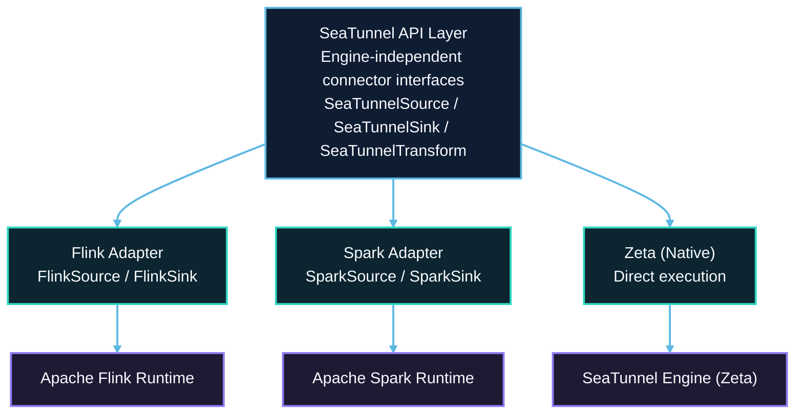

# Translation Layer Architecture

## 1. Overview

### 1.1 Problem Background

SeaTunnel provides a unified connector API, but jobs need to run on different execution engines:

- **Engine Diversity**: Flink, Spark, SeaTunnel Engine (Zeta) have different APIs
- **Code Duplication**: Without translation, each connector needs 3 implementations
- **Maintenance Burden**: Bug fixes require changes in all implementations
- **API Evolution**: Engine API changes break connectors
- **User Experience**: Users want consistent behavior across engines

### 1.2 Design Goals

SeaTunnel's translation layer aims to:

1. **Enable Portability**: Same connector runs on any engine
2. **Hide Complexity**: Connector developers only learn SeaTunnel API
3. **Maintain Fidelity**: Preserve semantic guarantees across engines
4. **Minimize Overhead**: Keep translation overhead low (depends on connectors and type conversions)
5. **Support Evolution**: Isolate connectors from engine API changes

### 1.3 Architecture Overview



### 1.4 Recommended Reading Path

Use this page as the cross-engine overview, then branch into the engine-specific pages:

- [Flink Translation Layer](./flink-translation-layer.md)
- [Spark Translation Layer](./spark-translation-layer.md)

Read the rest of this page when you want the combined view of shared translation concerns.

## 2. Flink Translation Layer

### 2.1 FlinkSource Adapter

Adapts `SeaTunnelSource` to Flink's `Source` interface. The Flink-side record type is always
`SeaTunnelRow`, splits are wrapped in `SplitWrapper`, and the enumerator state type is passed to
Flink as is.

```java
public class FlinkSource<SplitT extends SourceSplit, EnumStateT extends Serializable>
    implements Source<SeaTunnelRow, SplitWrapper<SplitT>, EnumStateT>,
        ResultTypeQueryable<SeaTunnelRow> {

    // Wrapped SeaTunnel source
    private final SeaTunnelSource<SeaTunnelRow, SplitT, EnumStateT> source;
    private final Config envConfig;

    @Override
    public Boundedness getBoundedness() {
        // Delegate to SeaTunnel source
        return source.getBoundedness() == org.apache.seatunnel.api.source.Boundedness.BOUNDED
            ? Boundedness.BOUNDED
            : Boundedness.CONTINUOUS_UNBOUNDED;
    }

    @Override
    public SourceReader<SeaTunnelRow, SplitWrapper<SplitT>> createReader(
        SourceReaderContext readerContext
    ) throws Exception {
        // Create SeaTunnel reader with adapted context
        org.apache.seatunnel.api.source.SourceReader.Context context =
            new FlinkSourceReaderContext(readerContext, source);
        org.apache.seatunnel.api.source.SourceReader<SeaTunnelRow, SplitT> reader =
            source.createReader(context);

        // Wrap in Flink adapter
        return new FlinkSourceReader<>(reader, context, envConfig);
    }

    @Override
    public SplitEnumerator<SplitWrapper<SplitT>, EnumStateT> createEnumerator(
        SplitEnumeratorContext<SplitWrapper<SplitT>> enumContext) throws Exception {

        // Readers that were told "no more splits", re-signaled after a failover
        Set<Integer> noMoreSplitsSignaledReaders = ConcurrentHashMap.newKeySet();

        // Create SeaTunnel enumerator with adapted context
        SourceSplitEnumerator<SplitT, EnumStateT> enumerator =
            source.createEnumerator(
                new FlinkSourceSplitEnumeratorContext<>(
                    enumContext, noMoreSplitsSignaledReaders::add));

        // Wrap in Flink adapter
        return new FlinkSourceEnumerator<>(enumerator, enumContext, noMoreSplitsSignaledReaders);
    }

    @Override
    public SimpleVersionedSerializer<SplitWrapper<SplitT>> getSplitSerializer() {
        // Adapt SeaTunnel serializer to Flink serializer
        return new SplitWrapperSerializer<>(source.getSplitSerializer());
    }

    @Override
    public SimpleVersionedSerializer<EnumStateT> getEnumeratorCheckpointSerializer() {
        return new FlinkSimpleVersionedSerializer<>(source.getEnumeratorStateSerializer());
    }
}
```

### 2.2 FlinkSourceReader Adapter

```java
public class FlinkSourceReader<SplitT extends SourceSplit>
    implements SourceReader<SeaTunnelRow, SplitWrapper<SplitT>> {

    private final org.apache.seatunnel.api.source.SourceReader<SeaTunnelRow, SplitT> sourceReader;
    private final org.apache.seatunnel.api.source.SourceReader.Context context;

    // Adapts Flink's ReaderOutput to SeaTunnel's Collector
    private final FlinkRowCollector flinkRowCollector;

    private InputStatus inputStatus = InputStatus.MORE_AVAILABLE;

    @Override
    public void start() {
        // Delegate to SeaTunnel reader
        try {
            sourceReader.open();
        } catch (Exception e) {
            throw new RuntimeException(e);
        }
    }

    @Override
    public InputStatus pollNext(ReaderOutput<SeaTunnelRow> output) throws Exception {
        // Poll from SeaTunnel reader through the adapted collector
        sourceReader.pollNext(flinkRowCollector.withReaderOutput(output));

        if (flinkRowCollector.isEmptyThisPollNext()) {
            // Schedules the availability future to complete after a short wait
            return InputStatus.NOTHING_AVAILABLE;
        }
        // Switched to END_OF_INPUT once the enumerator relays NoMoreElementEvent back
        return inputStatus;
    }

    @Override
    public void addSplits(List<SplitWrapper<SplitT>> splits) {
        // Unwrap and delegate
        sourceReader.addSplits(
            splits.stream().map(SplitWrapper::getSourceSplit).collect(Collectors.toList()));
    }

    @Override
    public void notifyCheckpointComplete(long checkpointId) throws Exception {
        sourceReader.notifyCheckpointComplete(checkpointId);
    }

    @Override
    public List<SplitWrapper<SplitT>> snapshotState(long checkpointId) {
        try {
            List<SplitT> state = sourceReader.snapshotState(checkpointId);

            // Wrap splits for Flink
            return state.stream()
                .map(SplitWrapper::new)
                .collect(Collectors.toList());
        } catch (Exception e) {
            throw new RuntimeException(e);
        }
    }
}
```

### 2.3 FlinkSourceEnumerator Adapter

```java
public class FlinkSourceEnumerator<SplitT extends SourceSplit, EnumStateT>
    implements SplitEnumerator<SplitWrapper<SplitT>, EnumStateT> {

    private final SourceSplitEnumerator<SplitT, EnumStateT> sourceSplitEnumerator;
    private final SplitEnumeratorContext<SplitWrapper<SplitT>> enumeratorContext;

    @Override
    public void start() {
        // Only opens the enumerator; run() is deferred until all readers have registered
        sourceSplitEnumerator.open();
    }

    @Override
    public void handleSplitRequest(int subtaskId, @Nullable String requesterHostname) {
        // Delegate to SeaTunnel enumerator
        sourceSplitEnumerator.handleSplitRequest(subtaskId);
    }

    @Override
    public void addSplitsBack(List<SplitWrapper<SplitT>> splits, int subtaskId) {
        // Unwrap and delegate
        List<SplitT> unwrappedSplits = splits.stream()
            .map(SplitWrapper::getSourceSplit)
            .collect(Collectors.toList());

        sourceSplitEnumerator.addSplitsBack(unwrappedSplits, subtaskId);
    }

    @Override
    public void addReader(int subtaskId) {
        sourceSplitEnumerator.registerReader(subtaskId);

        // Once every reader (one per parallel subtask) has registered,
        // run() is called a single time
        if (allReadersRegistered()) {
            sourceSplitEnumerator.run();
        }
    }

    @Override
    public EnumStateT snapshotState(long checkpointId) throws Exception {
        // The SeaTunnel enumerator state is checkpointed directly
        return sourceSplitEnumerator.snapshotState(checkpointId);
    }
}
```

### 2.4 Context Adapters

**FlinkSourceReaderContext**:
```java
public class FlinkSourceReaderContext
    implements org.apache.seatunnel.api.source.SourceReader.Context {

    private final SourceReaderContext readerContext;

    @Override
    public int getIndexOfSubtask() {
        return readerContext.getIndexOfSubtask();
    }

    @Override
    public void sendSplitRequest() {
        // Forward the request to Flink's SourceReaderContext
        readerContext.sendSplitRequest();
    }

    @Override
    public void sendSourceEventToEnumerator(SourceEvent event) {
        readerContext.sendSourceEventToCoordinator(
            new SourceEventWrapper(event)
        );
    }
}
```

**FlinkSourceSplitEnumeratorContext**:
```java
public class FlinkSourceSplitEnumeratorContext<SplitT extends SourceSplit>
    implements SourceSplitEnumerator.Context<SplitT> {

    private final SplitEnumeratorContext<SplitWrapper<SplitT>> flinkContext;

    @Override
    public int currentParallelism() {
        return flinkContext.currentParallelism();
    }

    @Override
    public Set<Integer> registeredReaders() {
        return flinkContext.registeredReaders().keySet();
    }

    @Override
    public void assignSplit(int subtaskId, List<SplitT> splits) {
        // Wrap and delegate
        List<SplitWrapper<SplitT>> wrappedSplits = splits.stream()
            .map(SplitWrapper::new)
            .collect(Collectors.toList());

        flinkContext.assignSplits(new SplitsAssignment<>(
            Collections.singletonMap(subtaskId, wrappedSplits)
        ));
    }

    @Override
    public void signalNoMoreSplits(int subtaskId) {
        flinkContext.signalNoMoreSplits(subtaskId);
    }

    @Override
    public void sendEventToSourceReader(int subtaskId, SourceEvent event) {
        flinkContext.sendEventToSourceReader(subtaskId, new SourceEventWrapper(event));
    }
}
```

### 2.5 FlinkSink Adapter

The snippet below follows `seatunnel-translation-flink-common` (Flink 1.x `Sink` API). Flink's
committable and writer-state types are wrappers around the SeaTunnel types (`CommitWrapper`,
`FlinkWriterState`), and the input record is a `SeaTunnelRow`. `seatunnel-translation-flink-20`
implements Flink's sink2 interfaces (`SupportsCommitter`, `SupportsWriterState`) instead.

```java
public class FlinkSink<InputT, CommT, WriterStateT, GlobalCommT>
    implements Sink<InputT, CommitWrapper<CommT>, FlinkWriterState<WriterStateT>, GlobalCommT> {

    private final SeaTunnelSink<SeaTunnelRow, WriterStateT, CommT, GlobalCommT> sink;
    private final int parallelism;

    @Override
    public SinkWriter<InputT, CommitWrapper<CommT>, FlinkWriterState<WriterStateT>> createWriter(
        Sink.InitContext context, List<FlinkWriterState<WriterStateT>> states) throws IOException {
        // Create SeaTunnel writer with adapted context
        org.apache.seatunnel.api.sink.SinkWriter.Context stContext =
            new FlinkSinkWriterContext(context, parallelism);

        if (states == null || states.isEmpty()) {
            return new FlinkSinkWriter<>(sink.createWriter(stContext), 1, stContext);
        }
        // Restore the SeaTunnel writer from the unwrapped states
        List<WriterStateT> restoredState =
            states.stream().map(FlinkWriterState::getState).collect(Collectors.toList());
        return new FlinkSinkWriter<>(
            sink.restoreWriter(stContext, restoredState),
            states.get(0).getCheckpointId() + 1,
            stContext);
    }

    @Override
    public Optional<Committer<CommitWrapper<CommT>>> createCommitter() throws IOException {
        return sink.createCommitter().map(FlinkCommitter::new);
    }

    @Override
    public Optional<GlobalCommitter<CommitWrapper<CommT>, GlobalCommT>> createGlobalCommitter()
        throws IOException {
        return sink.createAggregatedCommitter().map(FlinkGlobalCommitter::new);
    }

    @Override
    public Optional<SimpleVersionedSerializer<CommitWrapper<CommT>>> getCommittableSerializer() {
        return sink.getCommitInfoSerializer().map(CommitWrapperSerializer::new);
    }

    @Override
    public Optional<SimpleVersionedSerializer<FlinkWriterState<WriterStateT>>>
        getWriterStateSerializer() {
        return sink.getWriterStateSerializer().map(FlinkWriterStateSerializer::new);
    }
}
```

### 2.6 FlinkSinkWriter Adapter

```java
public class FlinkSinkWriter<InputT, CommT, WriterStateT>
    implements SinkWriter<InputT, CommitWrapper<CommT>, FlinkWriterState<WriterStateT>> {

    private final org.apache.seatunnel.api.sink.SinkWriter<SeaTunnelRow, CommT, WriterStateT> sinkWriter;
    private long checkpointId;
    private List<FlinkWriterState<WriterStateT>> pendingStates;

    @Override
    public void write(InputT element, Context context) throws IOException {
        // Delegate to SeaTunnel writer
        sinkWriter.write((SeaTunnelRow) element);
    }

    @Override
    public List<CommitWrapper<CommT>> prepareCommit(boolean flush) throws IOException {
        Optional<CommT> commitInfo = sinkWriter.prepareCommit(checkpointId);

        // Snapshot the state for the same checkpoint right after prepareCommit
        pendingStates = sinkWriter.snapshotState(checkpointId).stream()
            .map(state -> new FlinkWriterState<>(checkpointId, state))
            .collect(Collectors.toList());
        checkpointId++;

        return commitInfo.map(CommitWrapper::new)
            .map(Collections::singletonList)
            .orElse(Collections.emptyList());
    }

    @Override
    public List<FlinkWriterState<WriterStateT>> snapshotState() throws IOException {
        // Flink's snapshotState() takes no checkpoint ID; return the states taken in prepareCommit
        if (pendingStates != null) {
            List<FlinkWriterState<WriterStateT>> states = pendingStates;
            pendingStates = null;
            return states;
        }

        // Without a preceding prepareCommit (e.g. sinks without 2PC), snapshot directly
        List<FlinkWriterState<WriterStateT>> states = sinkWriter.snapshotState(checkpointId).stream()
            .map(state -> new FlinkWriterState<>(checkpointId, state))
            .collect(Collectors.toList());
        checkpointId++;
        return states;
    }

    @Override
    public void close() throws Exception {
        sinkWriter.close();
    }
}
```

## 3. Spark Translation Layer

Note: Spark 2.4 and Spark 3.x use different datasource APIs. SeaTunnel maintains separate Spark translation modules/adapters per Spark major version, so the exact adapter types and lifecycle hooks may differ.

### 3.1 Source Entry Point

The snippets in this section follow the Spark 2.4 DataSourceV2 adapters in
`seatunnel-translation-spark-2.4`. `SeaTunnelSourceSupport` (`DataSourceV2`, `ReadSupport`,
`MicroBatchReadSupport`) creates a `BatchSourceReader` for batch jobs. In Spark 3.3 the
equivalents are `SeaTunnelSparkSource` (`TableProvider`), `SeaTunnelScan`, `SeaTunnelBatch`,
`SeaTunnelBatchInputPartition` and `SeaTunnelBatchPartitionReader`.

Splits are not enumerated on the driver. `planInputPartitions()` creates one virtual partition per
subtask (or a single partition for sources that implement `SupportCoordinate`), and each partition
runs the SeaTunnel enumerator and reader inside its executor task.

```java
public class BatchSourceReader implements DataSourceReader {

    private final SeaTunnelSource<SeaTunnelRow, ?, ?> source;
    private final Integer parallelism;
    // jobId, envOptions and multiTableManager fields omitted

    @Override
    public StructType readSchema() {
        // Spark schema converted from the produced CatalogTables
        return multiTableManager.getTableSchema();
    }

    @Override
    public List<InputPartition<InternalRow>> planInputPartitions() {
        List<InputPartition<InternalRow>> virtualPartitions;
        if (source instanceof SupportCoordinate) {
            // One partition runs one enumerator and all readers
            virtualPartitions = new ArrayList<>(1);
            virtualPartitions.add(
                new BatchPartition(source, parallelism, jobId, 0, envOptions, multiTableManager));
        } else {
            // One partition per subtask; each one runs its own enumerator and reader
            virtualPartitions = new ArrayList<>(parallelism);
            for (int subtaskId = 0; subtaskId < parallelism; subtaskId++) {
                virtualPartitions.add(
                    new BatchPartition(
                        source, parallelism, jobId, subtaskId, envOptions, multiTableManager));
            }
        }
        return virtualPartitions;
    }
}
```

### 3.2 BatchPartition

```java
public class BatchPartition implements InputPartition<InternalRow> {

    private final SeaTunnelSource<SeaTunnelRow, ?, ?> source;
    private final Integer subtaskId;
    // parallelism, jobId, envOptions and multiTableManager fields omitted

    @Override
    public InputPartitionReader<InternalRow> createPartitionReader() {
        // ParallelBatchPartitionReader drives a ParallelSource (local enumerator + reader for this
        // subtask); CoordinatedBatchPartitionReader drives a CoordinatedSource
        ParallelBatchPartitionReader partitionReader =
            source instanceof SupportCoordinate
                ? new CoordinatedBatchPartitionReader(
                    source, parallelism, jobId, subtaskId, envOptions, multiTableManager)
                : new ParallelBatchPartitionReader(
                    source, parallelism, jobId, subtaskId, envOptions, multiTableManager);

        // Wrap in Spark adapter
        return new SeaTunnelInputPartitionReader(partitionReader);
    }
}
```

### 3.3 SeaTunnelInputPartitionReader

```java
public class SeaTunnelInputPartitionReader implements InputPartitionReader<InternalRow> {

    private final ParallelBatchPartitionReader partitionReader;

    @Override
    public boolean next() throws IOException {
        // The partition reader polls the SeaTunnel reader in a background thread and hands
        // rows over (already converted to InternalRow) through a queue
        try {
            return partitionReader.next();
        } catch (Exception e) {
            throw new RuntimeException(e);
        }
    }

    @Override
    public InternalRow get() {
        return partitionReader.get();
    }

    @Override
    public void close() throws IOException {
        partitionReader.close();
    }
}
```

### 3.4 SparkSink Adapter

`SparkSink` is the `WriteSupport` / `StreamWriteSupport` entry point; the commit logic lives in
`SparkDataSourceWriter` (driver side) and `SparkDataWriter` (executor side). Each `SparkDataWriter`
calls `prepareCommit` and the per-writer `SinkCommitter` inside `DataWriter#commit()`, and returns a
`SparkWriterCommitMessage`. The driver then runs the `SinkAggregatedCommitter`:

```java
public class SparkSink<StateT, CommitInfoT, AggregatedCommitInfoT>
    implements WriteSupport, StreamWriteSupport, DataSourceV2 {

    @Override
    public Optional<DataSourceWriter> createWriter(
        String writeUUID, StructType schema, SaveMode mode, DataSourceOptions options) {
        return Optional.of(new SparkDataSourceWriter<>(sink, catalogTables, jobId, parallelism));
    }
}

public class SparkDataSourceWriter<StateT, CommitInfoT, AggregatedCommitInfoT>
    implements DataSourceWriter {

    private final SinkAggregatedCommitter<CommitInfoT, AggregatedCommitInfoT> sinkAggregatedCommitter;

    @Override
    public DataWriterFactory<InternalRow> createWriterFactory() {
        return new SparkDataWriterFactory<>(sink, catalogTables, jobId, parallelism);
    }

    @Override
    public void commit(WriterCommitMessage[] messages) {
        if (sinkAggregatedCommitter != null) {
            try {
                sinkAggregatedCommitter.commit(combineCommitMessage(messages));
            } catch (IOException e) {
                throw new RuntimeException("SinkAggregatedCommitter commit failed in driver", e);
            }
        }
    }

    @Override
    public void abort(WriterCommitMessage[] messages) {
        if (sinkAggregatedCommitter != null) {
            try {
                sinkAggregatedCommitter.abort(combineCommitMessage(messages));
            } catch (Exception e) {
                throw new RuntimeException("SinkAggregatedCommitter abort failed in driver", e);
            }
        }
    }

    private List<AggregatedCommitInfoT> combineCommitMessage(WriterCommitMessage[] messages) {
        if (messages.length == 0) {
            return Collections.emptyList();
        }
        // Extract commit infos from messages and combine them into one aggregated commit info
        List<CommitInfoT> commitInfos = Arrays.stream(messages)
            .map(m -> ((SparkWriterCommitMessage<CommitInfoT>) m).getMessage())
            .filter(Objects::nonNull)
            .collect(Collectors.toList());
        return Collections.singletonList(sinkAggregatedCommitter.combine(commitInfos));
    }
}
```

## 4. Serialization Adapters

### 4.1 FlinkSimpleVersionedSerializer

```java
public class FlinkSimpleVersionedSerializer<T>
    implements SimpleVersionedSerializer<T> {

    private final org.apache.seatunnel.api.serialization.Serializer<T> seaTunnelSerializer;

    @Override
    public int getVersion() {
        // SeaTunnel's Serializer has no version, so the adapter always reports 0
        return 0;
    }

    @Override
    public byte[] serialize(T obj) throws IOException {
        return seaTunnelSerializer.serialize(obj);
    }

    @Override
    public T deserialize(int version, byte[] serialized) throws IOException {
        return seaTunnelSerializer.deserialize(serialized);
    }
}
```

## 5. Type Conversion

### 5.1 Spark Type Conversion

`TypeConverterUtils` in `seatunnel-translation-spark-common` converts SeaTunnel types to Spark
`DataType`s (simplified):

```java
public final class TypeConverterUtils {
    public static DataType convert(SeaTunnelDataType<?> dataType) {
        switch (dataType.getSqlType()) {
            case NULL:
                return DataTypes.NullType;
            case STRING:
                return DataTypes.StringType;
            case BOOLEAN:
                return DataTypes.BooleanType;
            case TINYINT:
                return DataTypes.ByteType;
            case SMALLINT:
                return DataTypes.ShortType;
            case INT:
                return DataTypes.IntegerType;
            case BIGINT:
                return DataTypes.LongType;
            case FLOAT:
                return DataTypes.FloatType;
            case DOUBLE:
                return DataTypes.DoubleType;
            case BYTES:
                return DataTypes.BinaryType;
            case DATE:
                return DataTypes.DateType;
            case TIME:
                // Spark has no TIME type; stored as LongType and flagged in the field metadata
                return DataTypes.LongType;
            case TIMESTAMP:
                return DataTypes.TimestampType;
            case TIMESTAMP_TZ:
                return OffsetDateTimeUtils.OFFSET_DATETIME_WITH_DECIMAL;
            case ARRAY:
                return DataTypes.createArrayType(
                    convert(((ArrayType<?, ?>) dataType).getElementType()));
            case MAP:
                MapType<?, ?> mapType = (MapType<?, ?>) dataType;
                return DataTypes.createMapType(
                    convert(mapType.getKeyType()), convert(mapType.getValueType()));
            case DECIMAL:
                DecimalType decimalType = (DecimalType) dataType;
                return new org.apache.spark.sql.types.DecimalType(
                    decimalType.getPrecision(), decimalType.getScale());
            case ROW:
                // Converted to a StructType; every StructField is nullable
                return convert((SeaTunnelRowType) dataType);
            default:
        }
        throw new IllegalArgumentException("Unsupported SeaTunnel's data type: " + dataType);
    }
}
```

## 6. Performance Considerations

### 6.1 Translation Overhead

Translation overhead depends on connector implementations, serialization, and type conversion complexity. Prefer measuring in your own workload rather than relying on fixed numbers.

### 6.2 Optimization Techniques

**Batch Type Conversion**:
```java
// ❌ BAD: Convert per record
public void collect(SeaTunnelRow record) {
    InternalRow sparkRow = convertToSparkRow(record);
    output.collect(sparkRow);
}

// ✅ GOOD: Batch convert (amortize overhead)
public void collect(List<SeaTunnelRow> records) {
    InternalRow[] sparkRows = batchConvertToSparkRows(records);
    for (InternalRow row : sparkRows) {
        output.collect(row);
    }
}
```

**Avoid Unnecessary Wrapping**:
```java
// If Split already serializable, don't wrap
public class SplitWrapper<T> {
    private final T split;

    // Lazy wrapping: only wrap when needed for serialization
    public byte[] serialize() {
        if (split instanceof Serializable) {
            return directSerialize(split); // No wrapping overhead
        } else {
            return wrapAndSerialize(split); // Fallback
        }
    }
}
```

## 7. Limitations and Workarounds

### 7.1 Engine-Specific Features

**Problem**: Some engine features have no SeaTunnel equivalent.

**Example**: Flink's `WatermarkStrategy`
```java
// Flink-specific watermark strategy cannot be expressed in SeaTunnel API
WatermarkStrategy<T> watermarkStrategy = WatermarkStrategy
    .forBoundedOutOfOrderness(Duration.ofSeconds(5));
```

**Workaround**: Provide engine-specific configuration
```hocon
source {
  Kafka {
    # SeaTunnel config
    topic = "my_topic"

    # Engine-specific config (for Flink only)
    flink.watermark.strategy = "bounded-out-of-orderness"
    flink.watermark.max-out-of-orderness = "5s"
  }
}
```

### 7.2 Type System Differences

**Problem**: Type systems don't fully align.

**Example**: Spark has `TimestampType`, Flink has `LocalZonedTimestampType` and `TimestampType`.

**Workaround**: Use least common denominator
```java
// SeaTunnel uses generic TIMESTAMP
// Translation layer maps to appropriate engine type based on config
```

## 8. Best Practices

### 8.1 Connector Development

**DO**:
- Implement SeaTunnel API only
- Test with multiple engines
- Use SeaTunnel types

**DON'T**:
- Reference engine-specific APIs in connector code
- Assume specific engine behavior
- Use engine-specific optimizations

### 8.2 Testing

**Test on All Engines**:
```java
@RunWith(Parameterized.class)
public class ConnectorTest {
    @Parameters
    public static Collection<Object[]> engines() {
        return Arrays.asList(new Object[][]{
            {"flink"},
            {"spark"},
            {"seatunnel"}
        });
    }

    @Test
    public void testExactlyOnce(String engine) {
        // Run same test on different engines
        runJobOnEngine(engine, jobConfig);
        verifyResults();
    }
}
```

## 9. Related Resources

- [Source Architecture](../api-design/source-architecture.md)
- [Sink Architecture](../api-design/sink-architecture.md)
- [Design Philosophy](../design-philosophy.md)

## 10. References

### Key Source Files

- Flink Translation: `seatunnel-translation/seatunnel-translation-flink/`
- Spark Translation: `seatunnel-translation/seatunnel-translation-spark/`
- Base Interfaces: `seatunnel-api/src/main/java/org/apache/seatunnel/api/`

### Further Reading

- [Apache Flink Source API](https://nightlies.apache.org/flink/flink-docs-stable/docs/dev/datastream/sources/)
- [Apache Spark Data Source V2](https://spark.apache.org/docs/latest/sql-data-sources.html)
