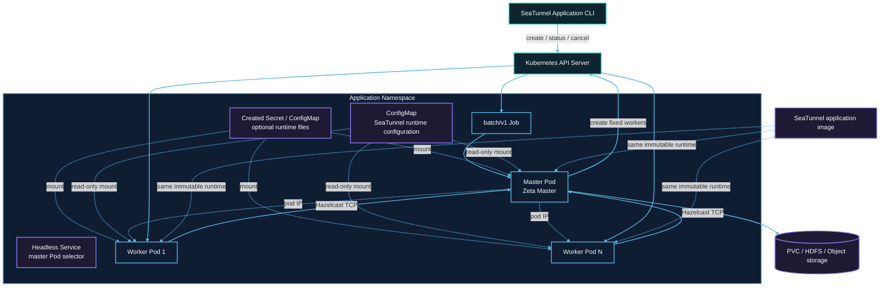

# Kubernetes cluster architecture

The following default layout uses one master. See [Opt-in application HA](#opt-in-application-ha) for the multi-master layout.

Each submission creates resources with a unique application ID in the target namespace. The Job Pod runs the master. Worker Pods do not mount Kubernetes API tokens and communicate with the master through Hazelcast TCP.



## Resource creation order

1. The submitter validates the user-owned runtime ConfigMap, then creates a suspended Job with `backoffLimit: 0`.
2. After receiving the Job UID, it creates the headless Service and, when `kubernetes.secret.*` or
   `kubernetes.configmap.<entry>.data` is configured, the owner-referenced application Secret and
   ConfigMap.
3. After the API confirms the dependent resources, it unsuspends the Job and returns the Job name without waiting for the master Pod. A TCP startup probe gives the Zeta master its configured startup window; readiness and liveness probes then check the Hazelcast master port. Use `status` or Pod events to observe slow image pulls, admission or scheduling problems.
4. The master starts an isolated Zeta cluster and creates a fixed number of worker Pods through the Kubernetes API. The master watches the application-labelled Pods through the Kubernetes watch API, so a deleted worker or a worker in a terminal phase is reported immediately; worker Pods carry no liveness probe.
5. Workers join the master over TCP at its Pod IP and register slots; the headless Service only selects the master Pod. Pod phase is used for failure detection; Zeta registration remains the source of worker readiness and slot capacity.
6. The master submits one Zeta job after every worker is ready.
7. After the job terminates, the master removes workers and exits. The Job records `Complete` or `Failed`.

## RBAC boundary

The submitter identity creates Jobs, Services, and the Secret/ConfigMap entries it declares, and
performs status and cancellation operations. The application ServiceAccount only needs to read its
Job and manage worker Pods. Only the master mounts the ServiceAccount token; workers do not access
the Kubernetes API.

## Network and capacity

Hazelcast TCP must be allowed between master and workers. A NetworkPolicy must permit application Pods to reach the master port and required member traffic.

The master does not provide task slots. Fixed capacity is:

```text
application.worker-count × application.worker.slots
```

Pod requests equal limits. Namespace quota, LimitRange, admission policies, and node capacity can prevent scheduling.

The Kubernetes API acknowledges Job, Secret, ConfigMap, and Service creation synchronously before the
Job is started. Runtime watches are therefore used for externally changing Pod lifecycle state. A
failed or ambiguous submission request compensates exactly the resources created by that submission,
so pre-existing resources with the same name are never deleted.

## Ownership and durable data

The created Secret/ConfigMap and the Service are owned by the Job and are garbage-collected when it
is deleted. Workers are explicitly cleaned by the application and carry application labels for
fallback deletion. Referenced ConfigMaps are user-owned, shared by the master and workers, and
retained after application cleanup.

A caller-owned checkpoint PVC has no Job owner reference, so success, failure, cancellation, or TTL expiry does not delete it. Remote checkpoint storage is also independent of the application lifecycle.

## Opt-in application HA

Set these deployment options to keep a fixed master and worker pool:

```hocon
kubernetes {
  ha.enabled = true
  master.replicas = 3
  ha.backup-count = 1
  checkpoint-pvc = "seatunnel-checkpoints"
}
```

HA is disabled by default. The existing single-master application and standalone modes keep their
previous behavior. HA requires at least two masters and a native backup count from 1 to 6, smaller
than the master count. `kubernetes.ha.backup-count` overrides the native
`seatunnel.engine.backup-count`; when omitted, the submitter's native engine configuration supplies
the value. The resolved value is carried to every master and worker. Invalid combinations fail
before any Kubernetes resource is created.

The Job becomes a retryable owner/observer. Separate StatefulSets maintain the desired master and
worker counts, including replacement after Pod deletion. Plan capacity for `master.replicas` masters,
`application.worker-count` workers and one additional owner Pod; the owner uses the master resource
and placement options. Only the owner mounts the Kubernetes API
token. Masters are native Hazelcast data members; workers are lite members. Zeta owns election,
replicated IMap state, slot registration, checkpoints and execution recovery. Kubernetes does not
elect a second leader or resubmit the native job. Allocation waits for all fixed workers to register
with Zeta; initial submission also waits for the requested native master count. HA uses native
`WAIT` scheduling so late registration does not reject the job. Native failure-detection and merge
timing determine recovery latency; initial startup and Kubernetes retry/deadline bounds remain
separate. During HA pipeline recovery, unavailable replacement slots are retried at the native
`job.retry.interval.seconds` interval without deploying stale allocations or consuming another
pipeline retry. Waiting and allocation do not hold the pipeline monitor. Accepted slots are recorded
before deployment; canceled or stopped recovery rejects new allocation and releases fresh slots.

The ClusterIP Service named by the application ID selects all masters and remains stable across
master Pod replacement. A separate `<application-id>-discovery` headless Service provides stable
StatefulSet peer addresses. Clients use the ClusterIP with smart routing disabled. A submitting
client using native job operations needs connectivity to that Service; a ClusterIP is not a public
ingress. `status` and application `cancel` only need Kubernetes API access.

### Ordinary HA submission and recovery boundaries

The owner records submission intent using a Job UID/resource-version compare-and-set before sending
one native submission with the original job ID. A replacement owner attaches to that ID. An
ambiguous request is never retried as a new job. Before native `RUNNING` has been recorded on the
owner Job, an unresolved startup beyond `application.startup-timeout-millis` records `FAILED` and
releases compute. A crash after intent but before native acceptance can therefore require an
explicit new application. This favors avoiding duplicate external side effects over transparent
retry of an unacknowledged submission.

The owner persists the first native `RUNNING` result with a UID/resource-version compare-and-set.
This is startup history, not a current health signal. Later unknown status or transport loss does
not turn the startup budget into a job failure, including after an observer reattaches. Compute is
retained until a confirmed native terminal outcome or explicit cancellation; unrecoverable native
state can require operator cancellation. Concurrent terminal results cannot be downgraded to
`RUNNING`, and a stale startup timeout cannot overwrite recorded `RUNNING`. Client connection and
initial master readiness still use the startup budget. Observer connection failures and Kubernetes
retry/deadline limits remain separate availability bounds. Use
`kubernetes.active-deadline-seconds` to bound Kubernetes startup or owner retries as a whole.

HA application status stays `DEPLOYING` until the observer records native `RUNNING`; running worker
Pods alone do not establish that the job started. An unrecognized lifecycle record is `UNKNOWN`.
If owner creation loses its response, the submitter has no acknowledged owner UID and does not
compensate by deleting resources by name or labels. Inspect the reported application ID and
reconcile the uncertain submission before retrying; a suspended owner may need operator cleanup.

A lost standby, active master or worker is replaced by Kubernetes. The surviving native masters
recover the original job using replicated state and retained checkpoints; the application ID and
native job ID remain unchanged. Owner replacement does not submit again. This requires surviving
native state and accessible durable checkpoint storage. Simultaneous loss of all masters, network
partitions, cross-cluster recovery and autoscaling are outside this feature's guarantee. Connector
replay and sink delivery guarantees remain native connector behavior.

:::caution
HA replicas recover from member loss; they do not fence disconnected coordinators. Native election
uses each component's local membership view, so a network partition may leave more than one active
coordinator. Synchronous map backups and shared checkpoint storage do not prevent concurrent sink
side effects. Data-structure quorum settings alone do not fence connector commits. Do not treat this
mode as safe for partitioned writers. A strict majority of two masters also cannot remain available
after one master is lost.
:::

Failure detection and rejoining use the configured native Hazelcast heartbeat and merge schedules;
restoring network connectivity does not imply immediate membership convergence. Checkpoint storage
outages are subject to native checkpoint and job retry limits. An extended outage can fail the job;
HA replicas do not make unavailable storage accessible.


Configure the same durable checkpoint backend, namespace and credentials on every master. A shared
PVC is optional when using a native remote backend such as HDFS or supported object storage. For
file-backed storage, mount `kubernetes.checkpoint-pvc` on all roles and use storage that permits the
chosen multi-node placement (typically ReadWriteMany). A single-node ReadWriteOnce test volume does
not demonstrate multi-node storage HA. The provider never deletes a referenced PVC or remote data. Custom checkpoint-storage plugins must
implement the fail-closed `getCheckpointsForRecovery` SPI before enabling application HA; the bundled
local-file and HDFS implementations support it.

### Ordinary HA terminal state and cleanup

The owner persists native `SUCCEEDED`, `FAILED` or `CANCELED` before deleting the owned StatefulSets
and Services. If cleanup fails, its replacement replays the persisted outcome and retries cleanup
without requiring a live engine endpoint. The Kubernetes owner Job may finish successfully even
when the native job failed: application `status` reads the persisted native outcome first.
Mounted owned ConfigMaps and Secrets remain until owner Job TTL expiry so a replacement observer can
start; Job garbage collection then removes them. `kubernetes.finished-job-retention-seconds`
controls this retention (default 86400). Resources merely referenced by the application remain
user-owned. Application `cancel` deletes the owner Job with a UID precondition and foreground
propagation; it removes all owned resources, rather than requesting a native savepoint. Status on
the canceled handle is `CANCELED`; a fresh handle sees `UNKNOWN` after deletion/TTL.

### HA permissions

In addition to the submitter's existing creation permissions, grant it `create` on
`apps/statefulsets` and `get` on Services for native client retrieval. The owner ServiceAccount
requires `get,patch` on Jobs, `get,delete` on StatefulSets, `list,delete` on Services, and `list` on
Pods to confirm compute cleanup. Masters and workers carry no Kubernetes API token. Use a dedicated
namespace and restrict who can patch owner Job annotations or modify referenced runtime files;
those are trusted control-plane inputs. No permission to delete PVCs, remote data, or referenced
ConfigMaps/Secrets is needed.
