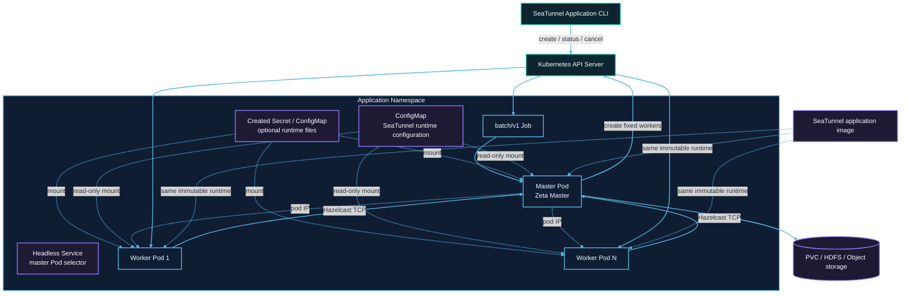

# Kubernetes cluster architecture

The following default layout uses one master. See [Opt-in application HA](#opt-in-application-ha) for the multi-master layout.

Each submission creates resources with a unique application ID in the target namespace. The Job Pod runs the master. Worker Pods do not mount Kubernetes API tokens and communicate with the master through Hazelcast TCP.



## Resource creation order

1. The submitter validates the user-owned runtime ConfigMap, then creates a suspended Job with `backoffLimit: 0`.
2. After receiving the Job UID, it creates the headless Service and, when `kubernetes.secret.*` or
   `kubernetes.configmap.<entry>.data` is configured, the owner-referenced application Secret and
   ConfigMap.
3. After the API confirms the dependent resources, it unsuspends the Job and returns the Job name without waiting for the master Pod. A TCP startup probe gives the Zeta master its configured startup window; readiness and liveness probes then check the Hazelcast master port. Use `status` or Pod events to observe slow image pulls, admission or scheduling problems.
4. The master starts an isolated Zeta cluster and creates a fixed number of worker Pods through the Kubernetes API. The master watches the application-labelled Pods through the Kubernetes watch API, so a deleted worker or a worker in a terminal phase is reported immediately; worker Pods carry no liveness probe.
5. Workers join the master over TCP at its Pod IP and register slots; the headless Service only selects the master Pod. Pod phase is used for failure detection; Zeta registration remains the source of worker readiness and slot capacity.
6. The master submits one Zeta job after every worker is ready.
7. After the job terminates, the master removes workers and exits. The Job records `Complete` or `Failed`.

## RBAC boundary

The submitter identity creates Jobs, Services, and the Secret/ConfigMap entries it declares, and
performs status and cancellation operations. The application ServiceAccount only needs to read its
Job and manage worker Pods. Only the master mounts the ServiceAccount token; workers do not access
the Kubernetes API.

## Network and capacity

Hazelcast TCP must be allowed between master and workers. A NetworkPolicy must permit application Pods to reach the master port and required member traffic.

The master does not provide task slots. Fixed capacity is:

```text
application.worker-count × application.worker.slots
```

Pod requests equal limits. Namespace quota, LimitRange, admission policies, and node capacity can prevent scheduling.

The Kubernetes API acknowledges Job, Secret, ConfigMap, and Service creation synchronously before the
Job is started. Runtime watches are therefore used for externally changing Pod lifecycle state. A
failed or ambiguous submission request compensates exactly the resources created by that submission,
so pre-existing resources with the same name are never deleted.

## Ownership and durable data

The created Secret/ConfigMap and the Service are owned by the Job and are garbage-collected when it
is deleted. Workers are explicitly cleaned by the application and carry application labels for
fallback deletion. Referenced ConfigMaps are user-owned, shared by the master and workers, and
retained after application cleanup.

A caller-owned checkpoint PVC has no Job owner reference, so success, failure, cancellation, or TTL expiry does not delete it. Remote checkpoint storage is also independent of the application lifecycle.

## Opt-in application HA

```hocon
kubernetes {
  ha.enabled = true
  master.replicas = 2
  ha.backup-count = 1
  checkpoint-pvc = "seatunnel-checkpoints"
}
```

HA is opt-in and supports exactly two native masters with one synchronous backup. Omitting
`kubernetes.ha.backup-count` selects `1`; the submitter's local engine configuration does not
change this value. Invalid topology or backup combinations fail before resource creation.
Single-master Application Mode and standalone mode keep their existing behavior.

A StatefulSet maintains the two masters. The active master uses the shared `ApplicationJobRunner`,
`ApplicationResourceManager` and Kubernetes driver to create a fixed set of worker Pods. A promoted
master attaches to those same workers. Workers are not replaced; worker loss fails the application.
Zeta owns election, replicated IMap state, slot registration, checkpoints and execution recovery.
There is no Kubernetes leader election or separate job execution loop.

A retryable owner Job observes persisted lifecycle metadata and finalizes resources. It does not
submit jobs or connect to Zeta. The owner requests 100m CPU and 128Mi memory; masters and workers
use their configured resources. The owner receives only namespace, job ID, timeout, specification digest and its owner UID; it has no job secrets, runtime mounts, checkpoint PVC or engine probes. Masters mount
the shared checkpoint PVC when configured. Workers have neither that mount nor Kubernetes API
credentials. Both masters and the owner use the application ServiceAccount.

The ClusterIP Service named by the application ID selects both masters and stays stable across
replacement. `<application-id>-discovery` is a headless Service for stable master peer addresses.
Native clients connect through the ClusterIP with smart routing disabled; they need network access
to that Service. Application `status` and `cancel` only require Kubernetes API access.

### Controller and runtime boundaries

This is the native Zeta HA follow-up to [STIP-41](https://github.com/apache/seatunnel/issues/11857)
and [#12886](https://github.com/apache/seatunnel/issues/12886). The proposed contract is sequential
active/standby master Pod replacement while at least one master and accessible checkpoints survive.
Node/storage experiments below are additional diagnostics, not a broader availability guarantee.

```text
Application CLI -> suspended owner Job (application ID, UID, immutable native job ID)
                -> master StatefulSet (2 replicas) + stable ClusterIP + master discovery Service
                -> unsuspend owner Job
master processes -> ApplicationJobRunner -> native coordinator election / replicated IMaps
active coordinator -> ApplicationResourceManager -> Kubernetes driver -> fixed worker Pods
owner observer -> owner Job metadata only -> UID-guarded terminal cleanup
```

The CLI assembles Kubernetes resources, the StatefulSet replaces masters, and the active native
coordinator owns job execution. Each coordinator activation gets a new provider driver; retiring
it stops its watches without deleting the fixed workers. The owner Job only observes persisted
status and retries cleanup. It neither elects a leader nor submits or restores a job.

The native takeover reconstructs the same job ID and validates all retained checkpoint entries
before scheduling. An old initialization cannot publish into a successor activation. Worker reports
are checked against their deployment execution ID. Neither mechanism fences external sink writers
across a network partition.

### Submission and recovery

Initial submission waits for both masters and all fixed workers. The active master claims submission
intent with a Job UID/resource-version compare-and-set, then submits the original native job ID.
After failover the promoted master waits for native coordinator restoration and attaches to that ID.
The driver from the retired coordinator detaches without deleting workers. An ambiguous submission
is never retried as a fresh job. A crash between claiming intent and native acceptance can require
an explicit new application.

The first native `RUNNING` observation is recorded on the owner Job. Until then status is `DEPLOYING`
and `application.startup-timeout-millis` bounds startup. After `RUNNING` has been recorded, missing
native status or an API interruption does not become a startup failure. Metadata publication errors
leave the native outcome unchanged. Operator cancellation can be needed if native state cannot be
recovered. `kubernetes.active-deadline-seconds` can bound owner retries as a whole.

A lost active or standby master is replaced by Kubernetes. Surviving native state and accessible
retained checkpoints are required to recover with the same application and job IDs. Owner restart
only retries observation and cleanup. Simultaneous loss of both masters, worker replacement,
autoscaling, cross-cluster recovery, strict network-partition protection and connector fencing are
outside this change. Connector replay and delivery guarantees remain those of the existing engine
and connector.

Worker terminal reports carry the existing deployment execution ID. The native master retains that
ID across takeover and invalidates it when retrying a pipeline, so a delayed report cannot cancel
a replacement execution or release its slots. Legacy untagged reports retain their existing behavior;
this check requires upgraded masters and workers and does not establish mixed-version HA safety.

:::caution
Two masters do not fence disconnected writers. Native election uses local membership, so a network
partition can leave more than one active coordinator. Synchronous backups and shared checkpoints
do not prevent concurrent sink side effects. This mode provides master failover, not strict
partition protection.
:::

Configure the same durable checkpoint backend, namespace and credentials on both masters. A shared
PVC is optional with a supported remote backend. File-backed multi-node deployments need storage
that permits their chosen placement, typically ReadWriteMany. A single-node ReadWriteOnce test does
not establish multi-node storage availability. Storage outages remain subject to native checkpoint
and job retry limits. The provider never deletes a referenced PVC or remote data.

Checkpoint recovery uses the existing `CheckpointStorage.getCheckpointsByJobIdAndPipelineId` API.
Bundled local-file and HDFS implementations fail on inaccessible or corrupt recovery state rather
than treating it as an empty checkpoint list. Custom plugins must preserve that distinction.
During master takeover, an initial checkpoint-list connection failure can be retried within the job's
`checkpoint.timeout` budget. Missing, corrupt or unauthorized state and failures after files were
observed still fail closed. Configure connection and request timeouts on the storage backend: the
retry budget does not interrupt an in-flight plugin call. Custom plugins can opt into safe retries
with `CheckpointStorageUnavailableException` only before observing any checkpoint state.
There is no new mandatory checkpoint-storage method. The HA provider capability is validated
before resource creation; custom Kubernetes clients must implement `KubernetesHaClient` to enable HA.
A nonstandard master entrypoint is rejected in HA mode.

### Terminal state and cleanup

The active master persists the first native `SUCCEEDED`, `FAILED` or `CANCELED` result. The owner
then deletes the master StatefulSet, owned worker Pods and Services with UID checks. If cleanup
fails, a replacement owner retries from persisted metadata without a live engine endpoint. The
owner Job may complete successfully even if the native job failed; application status uses the
persisted native result. Created mounted configuration and Secrets remain until owner Job TTL so
cleanup retries can start. Referenced user resources and durable data remain untouched.

Application `cancel` deletes the owner Job and its dependents immediately; it does not take a native
savepoint. HA cancellation uses a UID precondition. Single-master cancellation still cleans orphan Pods when the Job is already absent; the standard
client snapshots Job-owned Pods and checks their UID before deletion. The same canceled handle
returns `CANCELED`; a fresh handle returns `UNKNOWN` after deletion or TTL expiry.

### HA permissions

In addition to existing submission permissions, the submitter needs `apps/statefulsets` `create`
and Services `get`. The application ServiceAccount needs Jobs `get,patch`, Pods
`create,list,watch,delete,deletecollection`, StatefulSets `get,delete`, and Services `list,delete`.
Workers do not mount its token. Use a dedicated namespace and restrict modification of the owner
annotations and referenced runtime configuration. Neither identity needs permission to delete PVCs
or remote checkpoint data.

### Reproducible acceptance checks

The standard Kubernetes suite covers single-master compatibility and the two-master contract:

- Replace standby, active and observer Pods sequentially; require replacement Pod/native UUIDs,
  promotion of the surviving standby, stable application/job/Service identity, unchanged worker,
  and a newer completed checkpoint after each master rejoins.
- Keep one native client connected across these faults, then explicitly request native cancellation
  using a single scenario deadline and a completion handshake.
- Hold the bounded source tail behind a test-image-only gate while failing the active master;
  release it after recovery and compare all 240 committed IDs exactly.
- Cancel after committing IDs 0–119, explicitly restore a new application from that checkpoint,
  release IDs 120–239, and reconcile committed output from both applications after terminal status.
  Logs are diagnostics rather than the no-replay oracle. This is evidence for this test pipeline,
  not a connector-wide delivery guarantee.
- Verify success, sink failure, fixed-worker loss, cancellation, missing restore state, observer
  restart and cleanup retry; preserve user PVC/Secret/ConfigMap UIDs and data.

```bash
./mvnw -pl seatunnel-e2e/seatunnel-resource-managers-e2e verify \
  -DskipUT=true -DskipIT=false -Dskip.ui=true \
  -Djava.util.concurrent.ForkJoinPool.common.parallelism=3 \
  '-Dit.test=KubernetesApplication*IT'
```

The test fixture temporarily holds terminal compute cleanup with namespace RBAC only long enough
to read worker-local committed output, then restores permissions and verifies cleanup. It does not
mount the master's checkpoint PVC on workers or change a production connector.

### Multi-node failure validation

The opt-in Kubernetes E2E cases use three disposable K3s nodes and an S3-compatible checkpoint
backend. They check active/standby node loss with the same fixed worker, checkpoint-storage write
and read outages, master takeover during an outage, explicit checkpoint restore after recovery,
and cancellation/cleanup while storage is unavailable. User-owned storage and resources must survive.

After building and staging the E2E dependencies, run:

```bash
./mvnw -pl seatunnel-e2e/seatunnel-resource-managers-e2e verify \
  -DskipUT=true -DskipIT=false -Dseatunnel.kubernetes.e2e.multinode=true \
  '-Dit.test=KubernetesApplicationHaIT#*NodeLoss*+*Storage*'
```

The fixture requires privileged Docker with cgroup v2. The node fault freezes all processes of one
fixture node; surviving compute is removed before that node is thawed for teardown. These tests do
not exercise live network-partition healing or strict partition protection. All nodes run on one
Docker host, so this is not validation across independent physical hosts or storage systems.
