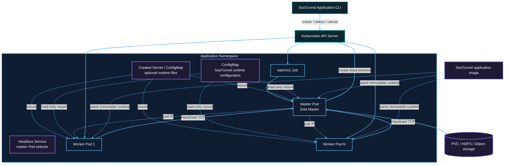

# Kubernetes cluster architecture

The following default layout uses one master. See [Opt-in application HA](#opt-in-application-ha) for the multi-master layout.

Each submission creates resources with a unique application ID in the target namespace. The Job Pod runs the master. Worker Pods do not mount Kubernetes API tokens and communicate with the master through Hazelcast TCP.



## Resource creation order

1. The submitter validates the user-owned runtime ConfigMap, then creates a suspended Job with `backoffLimit: 0`.
2. After receiving the Job UID, it creates the headless Service and, when `kubernetes.secret.*` or
   `kubernetes.configmap.<entry>.data` is configured, the owner-referenced application Secret and
   ConfigMap.
3. After the API confirms the dependent resources, it unsuspends the Job and returns the Job name without waiting for the master Pod. A TCP startup probe gives the Zeta master its configured startup window; readiness and liveness probes then check the Hazelcast master port. Use `status` or Pod events to observe slow image pulls, admission or scheduling problems.
4. The master starts an isolated Zeta cluster and creates a fixed number of worker Pods through the Kubernetes API. The master watches the application-labelled Pods through the Kubernetes watch API, so a deleted worker or a worker in a terminal phase is reported immediately; worker Pods carry no liveness probe.
5. Workers join the master over TCP at its Pod IP and register slots; the headless Service only selects the master Pod. Pod phase is used for failure detection; Zeta registration remains the source of worker readiness and slot capacity.
6. The master submits one Zeta job after every worker is ready.
7. After the job terminates, the master removes workers and exits. The Job records `Complete` or `Failed`.

## RBAC boundary

The submitter identity creates Jobs, Services, and the Secret/ConfigMap entries it declares, and
performs status and cancellation operations. The application ServiceAccount only needs to read its
Job and manage worker Pods. Only the master mounts the ServiceAccount token; workers do not access
the Kubernetes API.

## Network and capacity

Hazelcast TCP must be allowed between master and workers. A NetworkPolicy must permit application Pods to reach the master port and required member traffic.

The master does not provide task slots. Fixed capacity is:

```text
application.worker-count × application.worker.slots
```

Pod requests equal limits. Namespace quota, LimitRange, admission policies, and node capacity can prevent scheduling.

The Kubernetes API acknowledges Job, Secret, ConfigMap, and Service creation synchronously before the
Job is started. Runtime watches are therefore used for externally changing Pod lifecycle state. A
failed or ambiguous submission request compensates exactly the resources created by that submission,
so pre-existing resources with the same name are never deleted.

## Ownership and durable data

The created Secret/ConfigMap and the Service are owned by the Job and are garbage-collected when it
is deleted. Workers are explicitly cleaned by the application and carry application labels for
fallback deletion. Referenced ConfigMaps are user-owned, shared by the master and workers, and
retained after application cleanup.

A caller-owned checkpoint PVC has no Job owner reference, so success, failure, cancellation, or TTL expiry does not delete it. Remote checkpoint storage is also independent of the application lifecycle.

## Opt-in application HA

```hocon
kubernetes {
  ha.enabled = true
  master.replicas = 2
  ha.backup-count = 1
}
```

HA deploys two ordinary native Zeta masters and a fixed pool of worker Pods. A stable
ClusterIP provides client access; the headless discovery Service gives each master a distinct
peer address. Members advertise their own Pod addresses. Both masters must join the same cluster,
and all workers must join, before initial submission. One synchronous native map backup is configured.

### Deployment and native runtime

The suspended owner Job is created first. Its acknowledged UID owns the master StatefulSet,
Services, fixed worker Pods and generated configuration. After dependencies are created, the owner
is started as the sole native client. It prepares the graph and submits the immutable application
job ID through the existing Zeta client API. Masters use the existing standalone resource manager
for worker registration; they neither submit the application nor own Kubernetes worker cleanup.
Native Zeta handles election, scheduling and checkpoint recovery unchanged.

The owner is a submission client, not a metadata-only observer. It receives the resolved job
specification, required environment/Secret/ConfigMap mounts and plugin libraries. It uses the
configured master resources with a minimum 512Mi memory limit and the normal JVM heap ratio.
Masters and workers do not mount Kubernetes API tokens; only the owner needs in-cluster API access.

### Submission, failover and cleanup

- Initial submission waits for two native masters and the fixed worker count. Master replacement
  does not resubmit the graph or replace workers. Native master takeover retains the same job ID.
- Submission intent is recorded once using the owner UID and resource version. A lost submit
  acknowledgement is ambiguous: observe the existing job ID, never execute it again. Native
  `UNKNOWABLE`, a transport error or missing history is not a terminal success. If native recovery
  cannot recover the job, explicit application cancellation can be required.
- Native `FINISHED`/`SAVEPOINT_DONE`, `FAILED` and `CANCELED` results are persisted before cleanup.
  Cleanup retries API deletion failures and removes only generated resources owned by the observed
  owner UID, with individual resource UID preconditions. User PVCs and referenced configuration
  remain. Created mounted configuration remains until owner Job TTL.
- Workers are fixed `Never`-restart Pods. Losing a worker fails the deployment and removes its
  remaining compute; no worker replacement is provided.
- Application `cancel` deletes the owner by UID with foreground propagation. Its acknowledgement
  is distinct from observing that all dependent resources have disappeared.

The owner Job has no automatic retry, to avoid repeating ambiguous submissions. Owner process loss
is not covered by master HA: Kubernetes marks the Job failed, and its configured TTL collects owned
resources; explicit application cancellation can remove them sooner. This is not an Operator.

### Storage and guarantee limits

Every master must have access to the same retained checkpoints. Native storage semantics, retry
budgets and sink correctness are unchanged. Two masters do not provide quorum or fence partitioned
writers. Strict network-partition protection, simultaneous loss of both masters, worker replacement,
autoscaling, YARN HA and connector fencing are outside this feature.

### HA permissions

The submitter needs `create` for Jobs, StatefulSets, Pods, Services and generated Secrets/ConfigMaps,
plus the existing rollback permissions. Only the owner needs in-cluster `get`/`patch` for its Job,
`get`/`list` for Pods/StatefulSets/Services, and `delete` for owned compute and Services. RBAC remains
namespace scoped; no cluster-scoped permissions are required.

### Acceptance checks

Run `KubernetesApplicationHaIT` against the provider-only branch. Check active and standby master
loss, same native job and worker UID, renewed checkpoint progress, exact LocalFile output, native
cancellation, success/failure cleanup, API deletion retries and preservation of user resources.
These are local disposable Kubernetes checks, not a physical-host HA or partition-safety claim.
