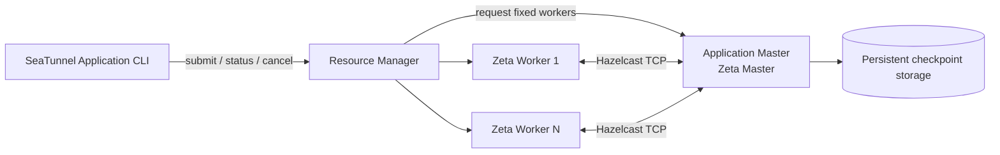

# Application Mode overview

Application Mode runs one independent SeaTunnel job per application. The resource platform starts a
dedicated master and a fixed number of workers, the master runs exactly one job, and the platform
reclaims every process when the application finishes. Zeta itself owns worker registration, slot
scheduling, task execution and checkpoints; the platform only provides and reclaims compute
resources.



## Cluster shape

- One application runs one Zeta master and a fixed number of workers; no member is added or removed
  while the job runs.
- Workers register their slots with the master before the single job starts.
- The master maps the job result to the platform state and releases the workers before it exits.
- Checkpoints live in engine-owned persistent storage and survive the application; a new application
  can restore them by native job ID.

## Command line

```bash
bin/seatunnel-application.sh submit -t <target> -c job.conf -a application.config
bin/seatunnel-application.sh status -t <target> --id APPLICATION_ID -a application.config --wait
bin/seatunnel-application.sh cancel -t <target> --id APPLICATION_ID -a application.config
```

| Option | Meaning |
| --- | --- |
| `-t`, `--target` | Resource platform that runs the application. |
| `-c`, `--config` | SeaTunnel job configuration file, required for submit. |
| `-a`, `--application-config` | Optional deployment file with common and platform options. |
| `--wait` | Submit/status wait for a terminal result; without it the command returns immediately. |
| `-ikey=value` | Non-sensitive deployment override, for example worker resources or platform options. |

`submit` returns as soon as the platform accepted the application; it does not wait for the master,
so slow image pulls or provider scheduling never fail the command. `status` and `cancel` only talk
to the platform API, and can be used after the master has exited.

## Requirements

- A supported resource platform provider must be present in the distribution.
- The platform must be able to start and observe the dedicated processes and clean them up when the
  application ends.
- Credentials stay outside the job file: inject them through platform-managed secrets and resolve
  them with `${VAR}` placeholders inside the application.

Platform-specific preparation, permissions and configuration are described in the platform guide.
