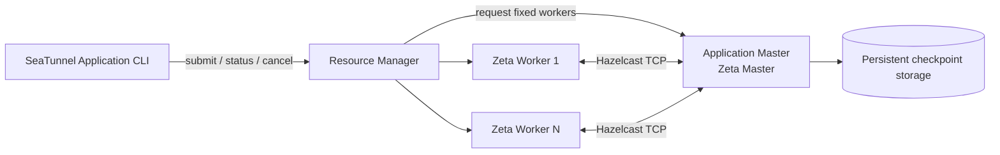

# About Application Mode

Application Mode runs one independent SeaTunnel job per application. The resource platform starts a
dedicated master and a fixed number of workers, the master runs exactly one job, and the platform
reclaims every process when the application finishes. Zeta itself owns worker registration, slot
scheduling, task execution and checkpoints; the platform only provides and reclaims compute
resources.

Application Mode is not a replacement for standalone or shared-cluster deployment. It is a
deployment mode of the same Zeta engine: one job becomes one self-contained application with its own
master and workers.



## What problem it solves

- No hand-written startup, discovery, submission, failure-propagation and cleanup scripts: one
  command submits an application that the platform starts, observes and reclaims.
- Per-job isolation: each job gets a dedicated master and a fixed worker set, so one job cannot
  disturb another and the application state maps directly to the platform state.
- Platform-native operations: status and cancel talk to the platform API, and credentials stay in
  platform-managed secrets instead of the job file.
- Checkpoints survive the application: a later application can restore the previous job by its
  native job ID.

## When to use Application Mode

- You already operate a resource platform and do not want to maintain a long-running shared
  SeaTunnel cluster.
- Each job should run in its own isolated cluster with a fixed resource footprint.
- The job lifecycle should be visible and manageable through platform-native objects.

## When not to use Application Mode

- Many small jobs should share one long-running cluster (use standalone or cluster deployment).
- The job needs dynamic worker scaling or automatic worker replenishment while it runs; Application
  Mode uses a fixed worker set and fails instead of scaling out.
- The distribution has no provider for your resource platform.

## Cluster shape

- One application runs one Zeta master and a fixed number of workers; no member is added or removed
  while the job runs.
- Workers register their slots with the master before the single job starts.
- The master maps the job result to the platform state and releases the workers before it exits.
- Checkpoints live in engine-owned persistent storage and survive the application; a new application
  can restore them by native job ID.

## Command line

```bash
bin/seatunnel-application.sh submit -t <target> -c job.conf -a application.config
bin/seatunnel-application.sh status -t <target> --id APPLICATION_ID -a application.config --wait
bin/seatunnel-application.sh cancel -t <target> --id APPLICATION_ID -a application.config
```

| Option | Meaning |
| --- | --- |
| `-t`, `--target` | Resource platform that runs the application. |
| `-c`, `--config` | SeaTunnel job configuration file, required for submit. |
| `-a`, `--application-config` | Optional deployment file with common and platform options. |
| `--wait` | Submit/status wait for a terminal result; without it the command returns immediately. |
| `-ikey=value` | Non-sensitive deployment override, for example worker resources or platform options. |

`submit` returns as soon as the platform accepted the application; it does not wait for the master,
so slow image pulls or provider scheduling never fail the command. `status` and `cancel` only talk
to the platform API, and can be used after the master has exited.

## Requirements

- A supported resource platform provider must be present in the distribution.
- The platform must be able to start and observe the dedicated processes and clean them up when the
  application ends.
- Credentials stay outside the job file: inject them through platform-managed secrets and resolve
  them with `${VAR}` placeholders inside the application.

Platform-specific preparation, permissions and configuration are described in the platform guide.

## Glossary

| Term | Definition |
| --- | --- |
| Application | One job plus its dedicated master and fixed workers, identified by the platform-native ID. |
| Master | The single Zeta member that runs the job, coordinates workers and publishes the result. |
| Worker | A fixed-size Zeta member that registers slots and executes tasks. |
| Resource manager | The Engine component that owns worker lifecycle through a platform driver. |
| Resource manager driver | The platform provider implementation that starts, observes and releases worker processes. |
| Application specification | The immutable, platform-independent application fields carried to the master. |
| Localized specification | The platform mechanism that delivers the specification to the master, such as mounted files or injected environment variables. |
| Checkpoint | Engine-owned durable state in persistent storage; independent of the application lifecycle. |

## Recommended reading order

| Phase | Document | Description |
| --- | --- | --- |
| Understand | This page | What Application Mode is, and when to use it. |
| Deep dive | [Architecture](architecture.md) | Resource-manager design, specification flow and lifecycle. |
| Try it out | Platform guide | Environment preparation, first submission and status inspection. |
| Configure | Platform guide | Platform options, credentials and runtime configuration. |
| Operate | Platform guide | Cancellation, failure diagnosis and retention behavior. |
