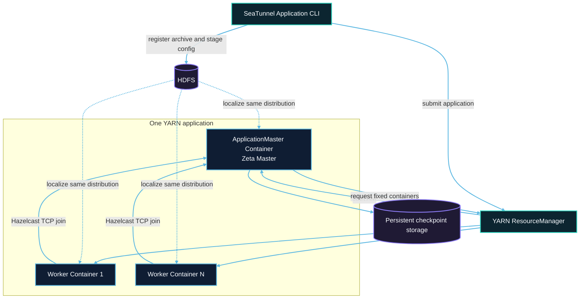

# YARN cluster architecture

Each submission creates one YARN application. The submission client prepares and uploads files. The ApplicationMaster then owns the master, workers, and job lifecycle.



## Submission lifecycle

1. The client allocates an application ID from the ResourceManager.
2. The client creates a private `0700` staging directory for configuration and the distribution manifest. It inspects a named snapshot on the staging HDFS in place. Other archives are copied into staging and inspected there. The manifest records the archive URL, size and modification time used by both roles.
3. The client status monitor waits for the ResourceManager to start the ApplicationMaster or report a terminal state. The NodeManager localizes and extracts the same distribution.
4. The ApplicationMaster starts an isolated Zeta master, registers with `AMRMClientAsync` and requests a fixed number of worker containers.
5. `NMClient` starts worker JVMs. Each allocated container is tracked as one worker node, and workers join the isolated Hazelcast cluster using the master's actual address.
6. After all workers register their membership and slots, the master submits one Zeta job.
7. When the job reaches a terminal state, the master releases workers, unregisters the YARN application, and removes staging.

## Identity and localization

On a simple-authentication cluster the containers use the configured Hadoop user. On a secure cluster the submitter logs in using a ticket or keytab, acquires the staging filesystem's delegation tokens, and attaches them to the AM launch context. The AM forwards HDFS tokens when it launches a worker.

The AM and worker factories each declare an ordered list of steps for their `YarnContainerSpec`, which wraps Hadoop's `ContainerLaunchContext`. The submission client uses the AM steps to stage the files declared by `build()` and then applies `decorate(spec)` to prepare the launch. Only the AM steps include the private job specification. The AM reads the size and timestamp of the worker files once and reuses that metadata when launching workers. Each worker launch receives fresh credentials.

NodeManagers expand the same `ARCHIVE` in each container. The AM also receives the application specification and selected job file, including a job generated from inline content. Shipped configuration files and the merged Hadoop XML reach both roles. Each worker resolves distribution JARs under its own localized installation.

The submitter polls the ResourceManager's application report while waiting for the AM to start. Inside the AM, Hadoop sends allocation heartbeats and delivers worker events to registered callbacks. `onContainersAllocated` starts workers through the NodeManager. `onContainersCompleted` reports unexpected exits to the engine with the container ID, exit status and diagnostics. If the ResourceManager asks the AM to shut down, the driver notifies the engine and stops accepting worker requests.

At DEBUG level, `YarnResourceManagerCallbackHandler` also logs container resource updates and NodeManager state changes. Workers keep the slots configured at startup. A decommissioning node can continue running its existing containers until YARN reports their completion.

### Worker events

An allocated container has a YARN container ID. Zeta counts its slots only after the worker JVM joins the AM and registers. Use the application attempt and container reports to distinguish a scheduler allocation from a worker that is ready to run tasks.

## Network and capacity

YARN containers use host networking. NodeManagers must allow the master Hazelcast port and worker ports. `application.master.port` is the starting master port. On collision, the master selects a later free port and passes the actual address to workers.

The ResourceManager application report exposes the master's Hazelcast address. The default native configuration uses an application-specific cluster name and does not authenticate native clients or members. Kerberos authenticates access to Hadoop services only. On a shared cluster, enable YARN ACLs and restrict who can view the application report. Also restrict network access to the Hazelcast ports on eligible NodeManagers to trusted application containers and authorized SeaTunnel clients. This restriction must cover other workloads on the same host. If tenants cannot be isolated, use dedicated nodes or a trusted cluster.

The master does not provide task slots. Fixed capacity is:

```text
application.worker-count × application.worker.slots
```

Requests must also fit queue quotas, the ResourceManager maximum container capability, and available NodeManager capacity.

When `yarn.master.http-port` is set, the AM binds a second, fixed port for HTTP or HTTPS and registers its NodeManager host and web address with the ResourceManager. Workers use the Hazelcast endpoint. Clients connecting directly to the UI and the YARN web proxy need access to the AM web port.

## Staging and checkpoints

Staging belongs to one application and is deleted after termination. Checkpoints must use a location outside staging. HDFS may localize the distribution while HDFS, OSS, S3, or COS stores checkpoints.

Losing the ApplicationMaster or a worker fails the current application. Recovery creates a new application and does not join the previous Hazelcast cluster. See [Checkpoint recovery](checkpoint-recovery.md).
