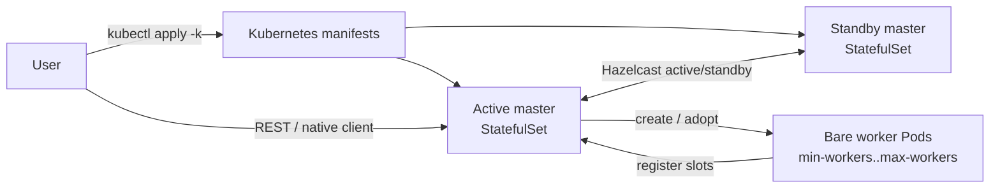

# Session Cluster

A Session Cluster is a long-running Zeta cluster shared by multiple jobs. Two masters form a
Hazelcast active/standby pair; the active master creates workers, and jobs are submitted through
REST or the native client.

Unlike [Application Mode](../application/overview.md), Session mode does not create a dedicated
master and worker set for each job.

## When to use Session mode

- Multiple batch or streaming jobs share one long-running cluster, avoiding per-job master startup.
- A team needs one REST or native-client endpoint for ad-hoc and scheduled submissions.
- Workloads can share a worker pool and grow within `min-workers` and `max-workers`.

## What Session mode provides

- Active/standby master election with two master replicas.
- Bare worker Pods created by the active master and adopted after master failover.
- Fixed-slot scheduling with slot-deficit scale-up and a configurable worker cap.
- Existing REST API and native client submission, with plain Kubernetes YAML deployment.

## Topology



Masters run as a two-replica StatefulSet. Workers are bare Pods owned by the root ConfigMap.
Slots are fixed; scale-up is capped by `max-workers`, and scale-down is not supported.

## Deploy

Read [Kubernetes Deployment](../kubernetes/kubernetes.mdx) and
[Kubernetes Configuration](../kubernetes/configuration.md) first. The Session image must contain
`seatunnel-session-cluster.sh` and the Kubernetes resource-manager provider.

```bash
kubectl apply -k deploy/kubernetes/session
```

The sample uses `conf/` for all master and worker configuration files. Kustomize generates one
`<session-name>-config` ConfigMap; the master mounts it whole and workers mount their required keys.

To run another Session in the same namespace, copy the directory and rename every session-scoped
resource, label, `session.yaml` value, `configMapGenerator` name, and Hazelcast/client DNS entry:

```bash
cp -R deploy/kubernetes/session /tmp/payments-session
# Edit /tmp/payments-session as described above.
kubectl apply -k /tmp/payments-session
```

## Configure

`conf/session.yaml` is the Session-specific configuration. Unknown keys are ignored; invalid values
fail master startup.

```yaml
session:
  name: seatunnel-session-cluster
  cluster-name: seatunnel-session-cluster
  root-config-map: seatunnel-session-cluster-meta

  master:
    port: 5801

  worker:
    image: apache/seatunnel:3.0.1
    min-workers: 2
    max-workers: 32
    slots: 8
    cpu-cores: 2
    memory-mb: 4096
    heap-mb: 3072
    jvm-options: "-Xms3g -Xmx3g"
    image-pull-policy: IfNotPresent
    service-account: default
    seatunnel-home: /opt/seatunnel
    config-map: seatunnel-session-cluster-config

    # Optional. Values are literals or secret:name/key and configmap:name/key.
    # env:
    #   AWS_REGION: us-east-1
    # env-from:
    #   secret: s3-credentials
    #   configmap: shared-settings
    # secret-ref: session-secret
    # secret-directory: /etc/seatunnel-secrets/session

  dynamic-worker:
    enabled: true
    startup-timeout-millis: 120000
    retry-interval-millis: 3000

kubernetes:
  namespace: seatunnel
```

:::caution Fixed slots

`session.worker.slots` must equal worker `seatunnel.yaml` `slot-service.slot-num`, and
`session.worker.config-map` must contain `seatunnel.yaml`, `hazelcast-worker.yaml`,
`log4j2.properties`, and `jvm_worker_options`.

:::

:::tip Session identity

`session.name` is a DNS-1123 label of at most 40 characters and must be unique when Sessions share
a namespace. `session.root-config-map` must already exist and have a server-assigned UID.

:::

`min-workers` defaults to `2`, `max-workers` to `32`, and `dynamic-worker.enabled` to `false`. Use
the master/worker engine and Hazelcast configuration from
[Separated Cluster Mode](../kubernetes/separated-cluster-mode.md); the sample `file:///tmp/` storage
is for local validation only.

## Start

```bash
kubectl apply -k deploy/kubernetes/session
kubectl -n seatunnel get pods -w
```

For status, logs, and REST access, see [Kubernetes Operations](../kubernetes/operations.md).

## Submit jobs

REST:

```bash
kubectl -n seatunnel port-forward svc/seatunnel-session-cluster-rest 8080:8080
curl -X POST http://127.0.0.1:8080/submit-job \
  -H 'Content-Type: application/json' \
  -d @job.json
```

Native client:

```bash
/opt/seatunnel/bin/seatunnel.sh --config job.conf -m cluster
```

The client configuration points at
`seatunnel-session-cluster-client.seatunnel.svc.cluster.local:5801`.

## Scaling

The active master creates `min-workers` at startup. When a pending job cannot get enough slots, it
creates `ceil(missingSlots / slotsPerWorker)` workers up to `max-workers`, waits for registration,
and retries allocation. `REJECT` fails after the startup timeout; `WAIT` keeps the job pending.

## Stop

Delete the master StatefulSet first, then the Session-scoped resources. Do not use
`kubectl delete -k` if the namespace hosts multiple Sessions.

```bash
SESSION_NAME=seatunnel-session-cluster

kubectl -n seatunnel delete statefulset "${SESSION_NAME}-master"
kubectl -n seatunnel delete configmap "${SESSION_NAME}-meta" "${SESSION_NAME}-config"
kubectl -n seatunnel delete service \
  "${SESSION_NAME}-headless" "${SESSION_NAME}-rest" "${SESSION_NAME}-client"
kubectl -n seatunnel delete pdb "${SESSION_NAME}-master"
```

User-owned checkpoints, PVCs, and referenced ConfigMaps/Secrets are not deleted.

## Limitations

- Worker template changes are not supported in place; create a new Session.
- No automatic scale-down or manual scale/spec API.
- No HA beyond the Hazelcast active/standby pair and StatefulSet restart.
- No multi-tenant quotas, Kerberos, or CPU-aware slot scheduling.
