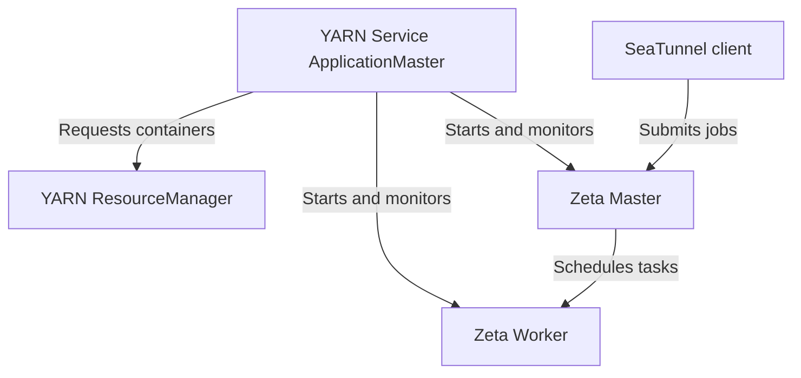

<!--
Licensed to the Apache Software Foundation (ASF) under one or more
contributor license agreements.  See the NOTICE file distributed with
this work for additional information regarding copyright ownership.
The ASF licenses this file to You under the Apache License, Version 2.0
(the "License"); you may not use this file except in compliance with
the License.  You may obtain a copy of the License at

    http://www.apache.org/licenses/LICENSE-2.0

Unless required by applicable law or agreed to in writing, software
distributed under the License is distributed on an "AS IS" BASIS,
WITHOUT WARRANTIES OR CONDITIONS OF ANY KIND, either express or implied.
See the License for the specific language governing permissions and
limitations under the License.
-->

# YARN Deployment

Use a Hadoop YARN Service to keep a shared SeaTunnel Zeta cluster running between jobs. The service's ApplicationMaster requests containers from YARN for the Zeta Master and Workers. Clients submit jobs to the Zeta Master, which schedules tasks on those Workers. The containers remain allocated to the service when a job finishes.

## Cluster layout

The example starts one Master and one Worker in separate containers. A single Master has no standby. For high availability, place at least two Masters on different hosts, configure their discovery addresses and size the IMap backup count for that topology. [Separated cluster deployment](../../engines/zeta/separated-cluster-deployment.md)

## Prerequisites

- A Hadoop cluster with HDFS and YARN Service enabled. The example uses Hadoop 3.3.6. Set `yarn.webapp.api-service.enable=true` on the ResourceManager. The submitting user needs write access to the HDFS staging and checkpoint directories and capacity in the queue for the ApplicationMaster, Master and Worker. [Hadoop YARN Service Quick Start](https://hadoop.apache.org/docs/r3.3.6/hadoop-yarn/hadoop-yarn-site/yarn-service/QuickStart.html)
- A stable Master hostname that the client and containers can resolve, and network access to the Zeta members. The example uses YARN Registry DNS. [YARN service discovery](https://hadoop.apache.org/docs/r3.3.6/hadoop-yarn/hadoop-yarn-site/yarn-service/ServiceDiscovery.html)
- A SeaTunnel binary distribution on the submission host and Java 11 or 17 on the submission host and in the containers. Set `SEATUNNEL_HOME` to the extracted distribution. The example uses SeaTunnel 3.1.0 with the FakeSource and Console connectors.

## Deploy and operate the cluster

- [Separated Cluster Mode](separated-cluster-mode.md) walks through staging the distribution, launching the service and submitting the first job.
- [YARN Configuration](configuration.md) lists the settings to change in the distribution before packaging it.
- [YARN Operations](operations.md) covers cluster status, Worker scaling, logs and service restarts.
