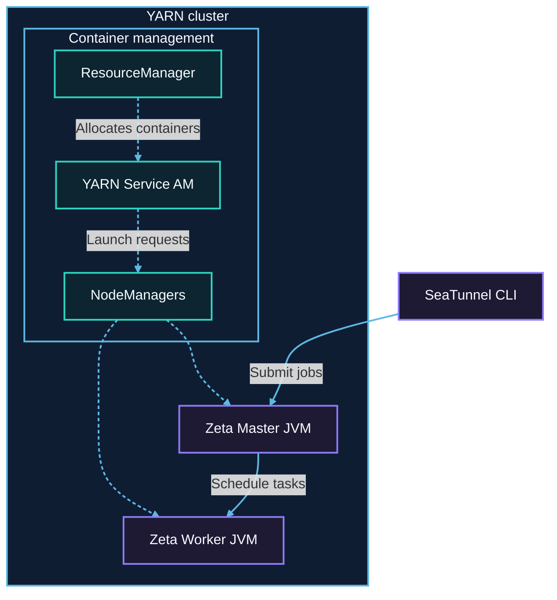

<!--
Licensed to the Apache Software Foundation (ASF) under one or more
contributor license agreements.  See the NOTICE file distributed with
this work for additional information regarding copyright ownership.
The ASF licenses this file to You under the Apache License, Version 2.0
(the "License"); you may not use this file except in compliance with
the License.  You may obtain a copy of the License at

    http://www.apache.org/licenses/LICENSE-2.0

Unless required by applicable law or agreed to in writing, software
distributed under the License is distributed on an "AS IS" BASIS,
WITHOUT WARRANTIES OR CONDITIONS OF ANY KIND, either express or implied.
See the License for the specific language governing permissions and
limitations under the License.
-->

# YARN Deployment

Run a single Zeta job in local mode or use a Hadoop YARN Service to keep a hybrid or separated cluster available for multiple jobs. In local mode the job releases its container when it finishes. In either cluster mode, subsequent jobs reuse the running Zeta members.

## Deployment modes

| Mode | YARN Service components | When to use it |
| --- | --- | --- |
| [Local mode](local-mode.md) | One `local` container runs the job with an embedded Zeta engine. | Trying a connector or running a one-off batch job. |
| [Hybrid cluster](hybrid-cluster-mode.md) | One `hybrid` component. Each container runs Master and Worker roles in one JVM. | Small clusters where scheduling and execution can share resources. |
| [Separated cluster](separated-cluster-mode.md) | Separate `master` and `worker` components. Each container runs one role. | Production clusters that need resource isolation or independent Worker scaling. |

## Separated cluster topology

In the `zeta-session` example, the YARN Service ApplicationMaster (AM) requests containers from the ResourceManager and asks the NodeManagers on the allocated hosts to start the Zeta Master and Worker. The SeaTunnel CLI submits jobs directly to the Zeta Master, which schedules tasks on the Worker.

## Prerequisites

- A Hadoop cluster with HDFS and YARN Service enabled. The example uses Hadoop 3.3.6. Set `yarn.webapp.api-service.enable=true` on the ResourceManager. The submitting user needs access to the HDFS staging directory and enough queue capacity for the ApplicationMaster and the containers in the selected mode. For jobs using HDFS checkpoints, grant write access to the checkpoint directory as well. [Hadoop YARN Service Quick Start](https://hadoop.apache.org/docs/r3.3.6/hadoop-yarn/hadoop-yarn-site/yarn-service/QuickStart.html)
- For hybrid and separated clusters, use stable discovery addresses for the hybrid members or Masters, resolvable by the client and the containers. Zeta members must be able to reach each other. The example uses YARN Registry DNS. [YARN service discovery](https://hadoop.apache.org/docs/r3.3.6/hadoop-yarn/hadoop-yarn-site/yarn-service/ServiceDiscovery.html)
- A SeaTunnel binary distribution on the submission host and Java 11 or 17 on the submission host and in the containers. Set `SEATUNNEL_HOME` to the extracted distribution. The example uses SeaTunnel 3.1.0 with the FakeSource and Console connectors.

## Deploy and operate the cluster

- [YARN Configuration](configuration.md) lists the settings to change in the distribution before packaging it.
- [YARN Operations](operations.md) covers cluster status, Worker scaling, logs and service restarts.
