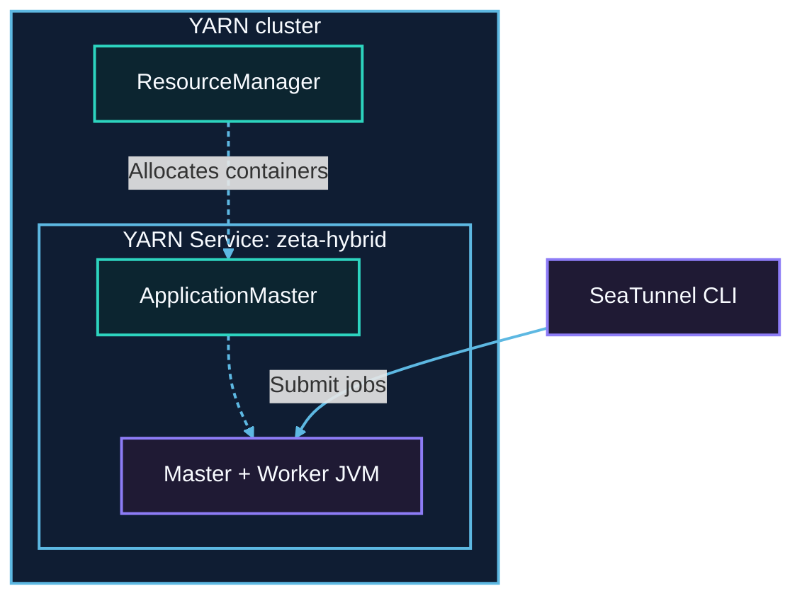
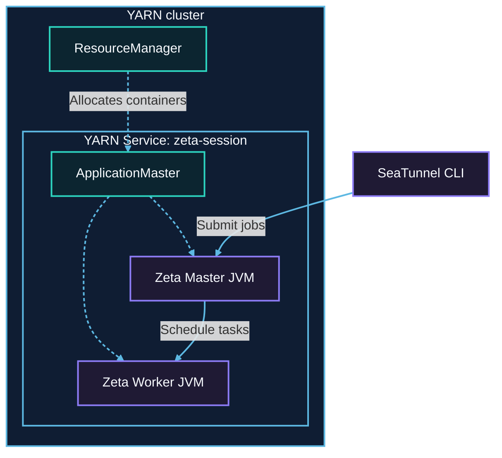

<!--
Licensed to the Apache Software Foundation (ASF) under one or more
contributor license agreements.  See the NOTICE file distributed with
this work for additional information regarding copyright ownership.
The ASF licenses this file to You under the Apache License, Version 2.0
(the "License"); you may not use this file except in compliance with
the License.  You may obtain a copy of the License at

    http://www.apache.org/licenses/LICENSE-2.0

Unless required by applicable law or agreed to in writing, software
distributed under the License is distributed on an "AS IS" BASIS,
WITHOUT WARRANTIES OR CONDITIONS OF ANY KIND, either express or implied.
See the License for the specific language governing permissions and
limitations under the License.
-->

# YARN Deployment

A Hadoop YARN Service keeps a shared SeaTunnel Zeta cluster running between jobs. Its ApplicationMaster requests containers from YARN. The SeaTunnel CLI submits jobs to the running Zeta cluster. When a job finishes, the service keeps its containers for the next job.

## Deployment modes

| Mode | YARN Service components | When to use it |
| --- | --- | --- |
| [Hybrid cluster](hybrid-cluster-mode.md) | One `hybrid` component. Each container runs Master and Worker roles in one JVM. | Small clusters where scheduling and execution can share resources. |
| [Separated cluster](separated-cluster-mode.md) | Separate `master` and `worker` components. Each container runs one role. | Production clusters that need resource isolation or independent Worker scaling. |

Dashed lines show container management. Solid lines show where jobs are submitted and scheduled.

### Hybrid cluster

The example has one hybrid member. With several members, each executes tasks and participates in Master election.

### Separated cluster

The example has one Master and one Worker. For Master failover, deploy at least two Masters on different hosts and configure discovery and IMap backups. [Separated cluster deployment](../../engines/zeta/separated-cluster-deployment.md)

## Prerequisites

- A Hadoop cluster with HDFS and YARN Service enabled. The example uses Hadoop 3.3.6. Set `yarn.webapp.api-service.enable=true` on the ResourceManager. The submitting user needs write access to the HDFS staging and checkpoint directories and capacity in the queue for the ApplicationMaster and the containers in the selected mode. [Hadoop YARN Service Quick Start](https://hadoop.apache.org/docs/r3.3.6/hadoop-yarn/hadoop-yarn-site/yarn-service/QuickStart.html)
- Stable discovery addresses for the hybrid members or Masters, resolvable by the client and the containers. Zeta members must be able to reach each other. The example uses YARN Registry DNS. [YARN service discovery](https://hadoop.apache.org/docs/r3.3.6/hadoop-yarn/hadoop-yarn-site/yarn-service/ServiceDiscovery.html)
- A SeaTunnel binary distribution on the submission host and Java 11 or 17 on the submission host and in the containers. Set `SEATUNNEL_HOME` to the extracted distribution. The example uses SeaTunnel 3.1.0 with the FakeSource and Console connectors.

## Deploy and operate the cluster

- [YARN Configuration](configuration.md) lists the settings to change in the distribution before packaging it.
- [YARN Operations](operations.md) covers cluster status, Worker scaling, logs and service restarts.
