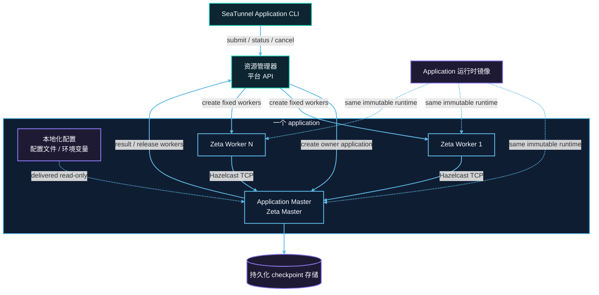

# Application Mode 架构

Application Mode 在 Engine 中增加了一层资源管理器。该层之下仍是常规 Zeta 运行时：Worker 注册、
slot 调度、任务执行、故障传播和 checkpoint。平台 provider 只负责启动、观测、回收进程，并把
application 结果映射为平台状态。

## 运行拓扑



## Engine 侧

```text
engine-client   部署 SPI：ApplicationClusterDescriptorFactory → ClusterDescriptor
engine-server   ApplicationResourceManager、ResourceManagerDriver SPI、ApplicationJobRunner
engine-common   ApplicationSpecification、WorkerSpecification、application 选项
```

- `ResourceManagerFactory` 为一个 application 创建 `StandaloneResourceManager` 或
  `ApplicationResourceManager`，接收 application ID、`ApplicationSpecification` 以及平台入口构造的 driver；
- `ApplicationResourceManager` 负责 driver 生命周期：初始化、等待固定 Worker 集合、资源故障通知、
  Worker 释放、终态发布和 driver 关闭；回调走主线程执行器，平台 SDK 操作走 IO 执行器；
- `ResourceManagerDriver` 是平台 provider 在资源生命周期上唯一需要实现的契约：
  initialize(handler, main executor, IO executor, master address)、requestWorker、releaseWorker、close；
  driver 不执行作业，也不把平台 SDK 类型带进 Engine；
- `ApplicationJobRunner` 等待 Worker 注册，运行且只运行一个作业，在中断或资源失败时取消作业，
  然后释放 Worker 并发布终态。

## 提交侧

- `ApplicationClusterDescriptorFactory` 通过部署 SPI 发现，为指定 target 选择 provider：校验 target、
  建立平台连接并返回 `ClusterDescriptor`；
- `ClusterDescriptor` 负责部署并返回平台原生 ID、发现运行中的 Master、查询持久化状态以及取消 application，
  都不依赖存活的 Engine 客户端；
- `ApplicationClusterDeployer` 加载 provider、调用 `deployApplication`，关闭本地 descriptor 但不停掉远端 application。

## 规格与本地化

- 提交端分别读取部署文件和作业文件；部署选项与不可变的 `ApplicationSpecification` 相互独立，
  specification 只包含 Master 需要的已解析字段；
- 作业文件原样带到 Master；Master 只解析一次，并用自身环境（包括平台注入的变量）解析全部
  `${...}` 占位符后执行；
- 本地化配置由平台机制承载，例如挂载配置文件或注入环境变量；Master 再从环境和挂载文件重建参数；
- application 自建的 Secret/ConfigMap 在 owner 资源之后创建并带 ownerReference，清理时只删除本次
  application 创建的对象，不会触碰用户已有资源。

## 生命周期

1. 提交端校验选项和用户管理的配置，创建 owner application 及其附属资源并启动；提交不等待 Master；
2. Master 启动 Zeta 成员，通过 driver 创建固定数量的 Worker，并在启动超时内等待注册；
3. Master 解析作业文件并执行唯一作业；Worker 丢失或资源故障使 application 失败，不会补拉 Worker；
4. 作业结束后 Master 释放 Worker、发布结果并退出；平台记录终态并回收剩余资源。

checkpoint 存储由引擎持有，独立于 application 生命周期，后续 application 可以按 job ID 恢复。

自定义挂载、环境变量、运行时配置等平台相关内容见对应平台指南。
