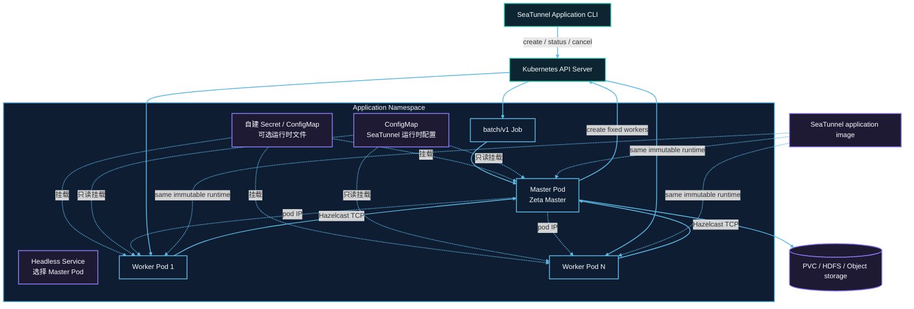

# Kubernetes 集群架构

以下为默认单 Master 架构；可选多 Master 模式见本页 Application HA 章节。

每次提交在目标 Namespace 中创建一组带唯一 application ID 的资源。Job Pod 运行 Master；Worker Pod 不挂载 Kubernetes API token，只通过 Hazelcast TCP 与 Master 通信。



## 资源创建顺序

1. 提交器先校验用户管理的运行时 ConfigMap，再创建 `backoffLimit: 0` 的挂起 Job。
2. 获得 Job UID 后，先创建 Headless Service；配置了 `kubernetes.secret.*` 或
   `kubernetes.configmap.<entry>.data` 时，再创建带 OwnerReference 的 application Secret 与
   ConfigMap。
3. Kubernetes API 确认依赖资源创建成功后，提交器解除 Job 挂起并返回 Job 名称，不等待 Master Pod 就绪。TCP startup probe 使用配置的启动超时等待 Zeta Master，随后 readiness 和 liveness probe 检查 Hazelcast Master 端口；镜像拉取慢、准入或调度问题通过 `status` 和 Pod 事件观察。
4. Master 启动独立 Zeta 集群，通过 Kubernetes API 创建固定数量的 Worker Pod。Master 通过 Kubernetes watch API 观察带 application label 的 Worker Pod，Pod 被删除或进入终止状态时立即上报；Worker 不配置 liveness probe。
5. Worker 通过 Master 的 Pod IP 以 TCP 加入集群并注册 slot；Headless Service 只负责选中 Master Pod。Pod phase 用于故障检测，Zeta 注册仍是 Worker 就绪和 slot 容量的判断依据。
6. 所有 Worker 就绪后，Master 提交唯一的 Zeta 作业。
7. 作业进入终态后，Master 删除 Worker 并退出；Job 状态保留为 `Complete` 或 `Failed`。

## RBAC 边界

提交端身份负责创建 Job、Service，以及自己声明的 Secret/ConfigMap 条目，并执行查询与取消。
Application ServiceAccount 只需要读取 Job 和管理本 application 的 Worker Pod。只有 Master 挂载
ServiceAccount token；Worker 不访问 Kubernetes API。

## 网络与容量

Master 与 Worker 之间必须允许 Hazelcast TCP。使用 NetworkPolicy 时，应放行 application 内 Pod 到 Master 端口，以及 Worker 的 Hazelcast 成员通信。

Master 不提供 task slot。总固定容量为：

```text
application.worker-count × application.worker.slots
```

Pod request 与 limit 使用相同 CPU、内存值。Namespace quota、LimitRange、准入策略和节点可用容量都可能阻止调度。

Job、Secret、ConfigMap 和 Service 的创建请求由 Kubernetes API 同步确认后才会启动 Job。运行时
watch 只观察会被外部控制器改变的 Pod 生命周期；提交请求失败或响应不明确时，只补偿本次提交创建
的资源，不会删除同名的已有资源。

## 所有权与持久数据

自建的 Secret/ConfigMap 和 Service 由 Job 持有，删除 Job 时由 Kubernetes 回收。Worker 由
application 显式清理，并使用 application 标签辅助兜底删除。引用的 ConfigMap 由用户管理，
Master 和 Worker 共同挂载，application 清理后仍会保留。

调用方提供的 checkpoint PVC 不设置 Job OwnerReference，因此成功、失败、取消或 TTL 到期都不会删除 PVC。远程 checkpoint 存储同样独立于 application 生命周期。

## 可选的 Application HA

在部署文件中配置固定 Master 和 Worker 池：

```hocon
kubernetes {
  ha.enabled = true
  master.replicas = 3
  ha.backup-count = 1
  checkpoint-pvc = "seatunnel-checkpoints"
}
```

默认不启用 HA；现有单 Master application 和 standalone 行为不变。HA 至少需要两个 Master，
原生 backup-count 必须为 1 到 6 且小于 Master 数量。`kubernetes.ha.backup-count` 覆盖原生
`seatunnel.engine.backup-count`；未设置时读取提交端原生引擎配置，并将解析后的值传递给所有成员。
非法组合在创建任何 Kubernetes 资源之前被拒绝。

Job 充当可重试的 owner/observer，独立的 StatefulSet 维护 Master 和 Worker 数量并补建丢失的 Pod。
容量规划需包括 `master.replicas` 个 Master、`application.worker-count` 个 Worker 及额外一个 owner Pod；
owner 使用 Master 的资源与调度选项。
只有 owner 挂载 Kubernetes API token；Master 为原生 Hazelcast data member，Worker 为 lite member。
选主、IMap 副本、slot 注册、checkpoint 和执行恢复全部由 Zeta 负责。Kubernetes 不维护第二套选主，
也不重新提交原生作业。初次提交等待全部原生 Master 加入；资源分配等待全部固定 Worker 在 Zeta 注册。
HA 使用原生 `WAIT` 调度，避免因注册延迟而拒绝作业。恢复延迟取决于原生成员故障检测与合并时序；
初始启动预算及 Kubernetes 重试或 deadline 是独立边界。
HA pipeline 恢复期间，替换 Worker 的原生 slot 尚未可用时，按 `job.retry.interval.seconds` 重试分配，
不部署旧分配结果，也不额外消耗 pipeline 重试次数。等待与资源分配不持有 pipeline monitor。
接受的 slot 在部署前记录所有权；取消或停止恢复后拒绝新分配，并释放本次新申请的 slot。

以 application ID 命名的 ClusterIP Service 选择所有 Master，在 Pod 替换后保持地址不变。
`<application-id>-discovery` Headless Service 提供 StatefulSet 成员的稳定发现地址。
原生客户端关闭 smart routing，经 ClusterIP 访问；需要到该 Service 的网络连通性，ClusterIP 并非公网入口。
Application `status` 和 `cancel` 仅需要访问 Kubernetes API。

### 普通 HA 的提交与恢复边界

owner 在首次原生提交前，通过 Job UID/resourceVersion CAS 持久记录提交意图，使用固定原生 job ID。
替换的 owner 只附着该 ID，不重复提交。不明确的提交结果不会作为新作业重试。
首次原生 `RUNNING` 尚未记录到 owner Job 时，若在 `application.startup-timeout-millis`
内无法确认启动，则记录 `FAILED` 并释放计算资源。因此，在记录意图后、原生接受前崩溃
可能需要显式创建新的 application，以避免重复外部副作用。

owner 通过 UID/resourceVersion CAS 持久记录首次原生 `RUNNING`，该记录表示已启动历史，
不代表当前健康状态。之后的未知状态或传输失败不会将启动预算变为作业失败期限；替换观察器
重新附着后也读取该历史。只有确认原生终态或显式取消才释放计算资源；原生状态无法恢复时
可能需要操作员取消。并发终态不能降级为 `RUNNING`，过期观察器的启动超时也不能覆盖
已记录的 `RUNNING`。客户端连接与初始 Master 就绪仍使用启动预算；观察器连接失败和
Kubernetes 重试或 deadline 仍构成独立的可用性边界。可用
`kubernetes.active-deadline-seconds` 约束整个 Kubernetes 启动与 owner 重试周期。

备用 Master、活动 Master 或 Worker 丢失后由 Kubernetes 补建。存活的原生 Master 利用副本状态和
checkpoint 恢复同一作业，application ID 与原生 job ID 不变；替换 owner 不重新提交。
这依赖仍存活的原生状态及可访问的持久 checkpoint。所有 Master 同时丢失、网络分区、跨集群恢复和
弹性伸缩不在本功能保证范围内。重放及 sink 交付语义仍取决于原生 connector。

:::caution
HA 副本用于成员丢失后的恢复，不会隔离网络分区中的旧协调器。原生选举依赖各分区的本地成员视图，
因此断网后可能存在多个活动协调器。同步 Map 副本和共享 checkpoint 存储不能阻止并发 Sink 副作用，
仅配置数据结构的 quorum 也不能为 Connector 提交提供 fencing。不要将此模式视为支持网络分区下的
安全写入。两个 Master 的严格多数要求两者都在线，因此也无法在丢失一个 Master 后继续提供服务。
:::

故障检测和重新加入沿用已配置的原生 Hazelcast 心跳与合并调度；网络恢复后成员视图不一定立即收敛。
checkpoint 存储中断受原生 checkpoint 和作业重试次数限制。长时间中断可能导致作业失败，HA 副本不能
替代可访问的持久存储。


所有 Master 必须使用一致的持久 checkpoint 后端、namespace 和凭据。使用 HDFS 或受支持对象存储时，
不要求 PVC。文件后端应通过 `kubernetes.checkpoint-pvc` 挂载给所有角色，并选用支持实际多节点部署的
存储（通常为 ReadWriteMany）。单节点 ReadWriteOnce 测试不代表多节点存储 HA。
provider 不删除引用的 PVC 或远程数据。自定义 checkpoint 存储插件必须实现失败时拒绝恢复的
`getCheckpointsForRecovery` SPI，才能启用 Application HA；内置 local-file 和 HDFS 实现已支持。

### 普通 HA 的终态和清理

owner 先持久记录原生 `SUCCEEDED`、`FAILED` 或 `CANCELED`，再删除自有 StatefulSet 和 Service。
清理失败时，替换 owner 无需连接引擎即可重放终态并重试。即使原生作业失败，owner Job 仍可能成功完成；
application `status` 优先读取持久原生终态。自建且已挂载的 ConfigMap/Secret 保留至 owner Job TTL，
确保替换 owner 能启动，然后随 Job 垃圾回收删除。
`kubernetes.finished-job-retention-seconds` 控制保留期（默认 86400 秒）。引用的用户资源始终保留。
Application `cancel` 使用 UID 前置条件和 foreground 传播删除 owner 及全部自有资源，不请求原生 savepoint。
同一 handle 返回 `CANCELED`；删除或 TTL 之后新 handle 返回 `UNKNOWN`。

### HA 权限

提交身份在已有权限之外需要 `apps/statefulsets` 的 `create` 和 Service 的 `get`（原生客户端检索）。
owner ServiceAccount 需要 Job 的 `get,patch`、StatefulSet 的 `get,delete`、Service 的 `list,delete`，
以及 Pod 的 `list` 以确认计算资源已清理。Master 与 Worker 不挂载 Kubernetes API token。
使用专用 namespace，并限制修改 owner Job annotations 和引用配置文件的权限；它们是可信控制输入。
不需要删除 PVC、远程数据或引用 ConfigMap/Secret 的权限。

### HA 状态与不确定提交

只有 observer 记录原生作业 `RUNNING` 后，HA application 才报告 `RUNNING`；Worker Pod 已运行不能证明作业已启动。
未知的生命周期记录返回 `UNKNOWN`。若创建 owner 的响应丢失，提交端未取得已确认的 UID，不能按名称或标签删除资源。
请根据错误中的 application ID 检查并协调不确定的提交，再决定重试；暂停的 owner 可能需要管理员清理。
