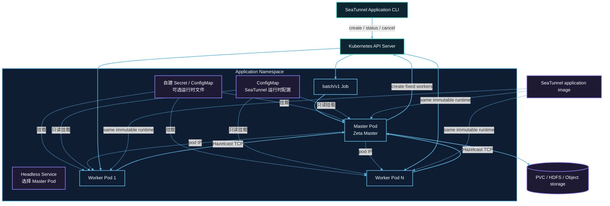

# Kubernetes 集群架构

以下为默认单 Master 架构；可选多 Master 模式见本页 Application HA 章节。

每次提交在目标 Namespace 中创建一组带唯一 application ID 的资源。Job Pod 运行 Master；Worker Pod 不挂载 Kubernetes API token，只通过 Hazelcast TCP 与 Master 通信。



## 资源创建顺序

1. 提交器先校验用户管理的运行时 ConfigMap，再创建 `backoffLimit: 0` 的挂起 Job。
2. 获得 Job UID 后，先创建 Headless Service；配置了 `kubernetes.secret.*` 或
   `kubernetes.configmap.<entry>.data` 时，再创建带 OwnerReference 的 application Secret 与
   ConfigMap。
3. Kubernetes API 确认依赖资源创建成功后，提交器解除 Job 挂起并返回 Job 名称，不等待 Master Pod 就绪。TCP startup probe 使用配置的启动超时等待 Zeta Master，随后 readiness 和 liveness probe 检查 Hazelcast Master 端口；镜像拉取慢、准入或调度问题通过 `status` 和 Pod 事件观察。
4. Master 启动独立 Zeta 集群，通过 Kubernetes API 创建固定数量的 Worker Pod。Master 通过 Kubernetes watch API 观察带 application label 的 Worker Pod，Pod 被删除或进入终止状态时立即上报；Worker 不配置 liveness probe。
5. Worker 通过 Master 的 Pod IP 以 TCP 加入集群并注册 slot；Headless Service 只负责选中 Master Pod。Pod phase 用于故障检测，Zeta 注册仍是 Worker 就绪和 slot 容量的判断依据。
6. 所有 Worker 就绪后，Master 提交唯一的 Zeta 作业。
7. 作业进入终态后，Master 删除 Worker 并退出；Job 状态保留为 `Complete` 或 `Failed`。

## RBAC 边界

提交端身份负责创建 Job、Service，以及自己声明的 Secret/ConfigMap 条目，并执行查询与取消。
Application ServiceAccount 只需要读取 Job 和管理本 application 的 Worker Pod。只有 Master 挂载
ServiceAccount token；Worker 不访问 Kubernetes API。

## 网络与容量

Master 与 Worker 之间必须允许 Hazelcast TCP。使用 NetworkPolicy 时，应放行 application 内 Pod 到 Master 端口，以及 Worker 的 Hazelcast 成员通信。

Master 不提供 task slot。总固定容量为：

```text
application.worker-count × application.worker.slots
```

Pod request 与 limit 使用相同 CPU、内存值。Namespace quota、LimitRange、准入策略和节点可用容量都可能阻止调度。

Job、Secret、ConfigMap 和 Service 的创建请求由 Kubernetes API 同步确认后才会启动 Job。运行时
watch 只观察会被外部控制器改变的 Pod 生命周期；提交请求失败或响应不明确时，只补偿本次提交创建
的资源，不会删除同名的已有资源。

## 所有权与持久数据

自建的 Secret/ConfigMap 和 Service 由 Job 持有，删除 Job 时由 Kubernetes 回收。Worker 由
application 显式清理，并使用 application 标签辅助兜底删除。引用的 ConfigMap 由用户管理，
Master 和 Worker 共同挂载，application 清理后仍会保留。

调用方提供的 checkpoint PVC 不设置 Job OwnerReference，因此成功、失败、取消或 TTL 到期都不会删除 PVC。远程 checkpoint 存储同样独立于 application 生命周期。

## 可选 Application HA

```hocon
kubernetes {
  ha.enabled = true
  master.replicas = 2
  ha.backup-count = 1
}
```

HA 部署两个普通原生 Zeta Master 和固定 Worker Pod。ClusterIP 提供稳定的客户端入口，headless
Service 提供各 Master 独立的发现地址；成员公布自己的 Pod 地址。首次提交前等待两个 Master
及全部 Worker 加入同一集群，元数据使用一个原生同步备份。

### 部署与原生运行时

先创建 suspended owner Job，再用服务端确认的 owner UID 创建 Master StatefulSet、Service、
固定 Worker Pod 和生成的配置，最后启动 owner。owner 是唯一原生提交客户端：准备作业图并通过
现有 Zeta 客户端 API 提交固定作业 ID。Master 使用现有 standalone 资源管理器注册 Worker，
不提交作业也不清理 Kubernetes Worker。选举、调度、检查点恢复及任务协议保持不变。

owner 不再是仅观察元数据的进程，它接收作业配置、所需环境变量、Secret/ConfigMap 挂载和插件，
使用配置的 Master 资源、至少 512Mi 内存以及正常 JVM 堆比例。只有 owner 使用 Kubernetes API
令牌，Master 和 Worker 不挂载该令牌。

### 提交、切换与清理

- 首次提交等待两个 Master 和固定数量 Worker。Master 替换不会重新提交作业，也不会补充 Worker。
  原生接管保留相同作业 ID。
- 提交意图通过 owner UID 和 resourceVersion 记录一次。提交确认丢失时只观察原有作业 ID，不能重提。
  `UNKNOWABLE`、连接异常或历史记录缺失均不表示成功；原生恢复无法完成时可能需要显式取消应用。
- 原生 `FINISHED`/`SAVEPOINT_DONE`、`FAILED`、`CANCELED` 先持久化，再清理计算资源。
  API 删除失败会重试，清理同时校验 owner UID 和资源 UID，只删除本应用生成的资源。
  用户 PVC 和引用配置不删除；生成的挂载配置保留至 owner Job TTL。
- Worker 为固定且不重启的 Pod，丢失 Worker 会失败并释放剩余计算资源，不自动补充。
- 应用 cancel 以 UID 前置条件和 foreground 传播删除 owner；删除确认不等于已观察到全部依赖消失。

owner Job 不自动重试，以免重复含糊的提交。owner 进程丢失不属于 Master HA：Job 会失败，
Kubernetes 在配置 TTL 到期后回收其依赖，显式取消可以提前删除。本功能不是 Operator。

### 存储与保证边界

所有 Master 必须能访问相同的保留检查点。原生存储语义、重试限制和 sink 正确性不变。
两个 Master 不提供 quorum 或分区写入 fencing。严格网络分区保护、同时丢失两个 Master、
Worker 补充、弹性扩缩、YARN HA 和连接器 fencing 均不在范围内。

### HA 权限

提交端需要创建 Job、StatefulSet、Pod、Service 及生成的 Secret/ConfigMap，并具备现有回滚权限。
仅 owner 需要读取/patch 自己的 Job、读取/list Pod/StatefulSet/Service，以及删除自身计算资源和
Service 的权限。RBAC 限定 namespace，不需要集群级权限。

### 验收

在仅平台变更的分支运行 `KubernetesApplicationHaIT`，验证 active/standby Master 丢失、相同作业和
Worker UID、新检查点、LocalFile 精确输出、原生取消、成功/失败清理、API 删除重试及用户资源保留。
本地临时 Kubernetes 测试不证明物理主机 HA 或网络分区安全。
