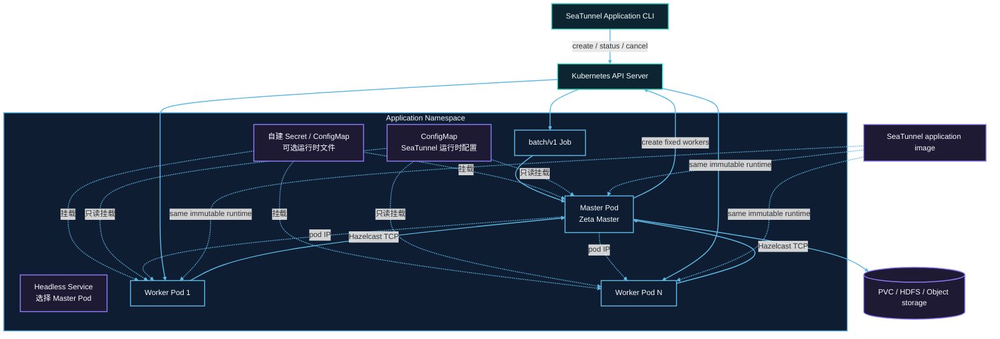

# Kubernetes 集群架构

以下为默认单 Master 架构；可选多 Master 模式见本页 Application HA 章节。

每次提交在目标 Namespace 中创建一组带唯一 application ID 的资源。Job Pod 运行 Master；Worker Pod 不挂载 Kubernetes API token，只通过 Hazelcast TCP 与 Master 通信。



## 资源创建顺序

1. 提交器先校验用户管理的运行时 ConfigMap，再创建 `backoffLimit: 0` 的挂起 Job。
2. 获得 Job UID 后，先创建 Headless Service；配置了 `kubernetes.secret.*` 或
   `kubernetes.configmap.<entry>.data` 时，再创建带 OwnerReference 的 application Secret 与
   ConfigMap。
3. Kubernetes API 确认依赖资源创建成功后，提交器解除 Job 挂起并返回 Job 名称，不等待 Master Pod 就绪。TCP startup probe 使用配置的启动超时等待 Zeta Master，随后 readiness 和 liveness probe 检查 Hazelcast Master 端口；镜像拉取慢、准入或调度问题通过 `status` 和 Pod 事件观察。
4. Master 启动独立 Zeta 集群，通过 Kubernetes API 创建固定数量的 Worker Pod。Master 通过 Kubernetes watch API 观察带 application label 的 Worker Pod，Pod 被删除或进入终止状态时立即上报；Worker 不配置 liveness probe。
5. Worker 通过 Master 的 Pod IP 以 TCP 加入集群并注册 slot；Headless Service 只负责选中 Master Pod。Pod phase 用于故障检测，Zeta 注册仍是 Worker 就绪和 slot 容量的判断依据。
6. 所有 Worker 就绪后，Master 提交唯一的 Zeta 作业。
7. 作业进入终态后，Master 删除 Worker 并退出；Job 状态保留为 `Complete` 或 `Failed`。

## RBAC 边界

提交端身份负责创建 Job、Service，以及自己声明的 Secret/ConfigMap 条目，并执行查询与取消。
Application ServiceAccount 只需要读取 Job 和管理本 application 的 Worker Pod。只有 Master 挂载
ServiceAccount token；Worker 不访问 Kubernetes API。

## 网络与容量

Master 与 Worker 之间必须允许 Hazelcast TCP。使用 NetworkPolicy 时，应放行 application 内 Pod 到 Master 端口，以及 Worker 的 Hazelcast 成员通信。

Master 不提供 task slot。总固定容量为：

```text
application.worker-count × application.worker.slots
```

Pod request 与 limit 使用相同 CPU、内存值。Namespace quota、LimitRange、准入策略和节点可用容量都可能阻止调度。

Job、Secret、ConfigMap 和 Service 的创建请求由 Kubernetes API 同步确认后才会启动 Job。运行时
watch 只观察会被外部控制器改变的 Pod 生命周期；提交请求失败或响应不明确时，只补偿本次提交创建
的资源，不会删除同名的已有资源。

## 所有权与持久数据

自建的 Secret/ConfigMap 和 Service 由 Job 持有，删除 Job 时由 Kubernetes 回收。Worker 由
application 显式清理，并使用 application 标签辅助兜底删除。引用的 ConfigMap 由用户管理，
Master 和 Worker 共同挂载，application 清理后仍会保留。

调用方提供的 checkpoint PVC 不设置 Job OwnerReference，因此成功、失败、取消或 TTL 到期都不会删除 PVC。远程 checkpoint 存储同样独立于 application 生命周期。

## 可选 Application HA

```hocon
kubernetes {
  ha.enabled = true
  master.replicas = 2
  ha.backup-count = 1
  checkpoint-pvc = "seatunnel-checkpoints"
}
```

HA 默认关闭，仅支持两个原生 Master 和一个同步备份。省略 backup-count 时固定使用 1，
不读取提交端本地引擎配置。无效组合在创建资源前失败；单 Master 和 standalone 行为不变。

StatefulSet 维护两个 Master。活动 Master 复用 `ApplicationJobRunner`、
`ApplicationResourceManager` 和 Kubernetes driver 创建固定 Worker Pod。切换后连接原有 Worker，
不自动补建；Worker 丢失使 application 失败。选主、IMap 复制、slot、checkpoint 和执行恢复由 Zeta 负责。

可重试 owner Job 仅观测持久状态并清理资源，不提交作业或连接引擎。owner 请求 100m CPU、128Mi 内存，
仅接收 namespace、job ID、超时、spec digest 和 owner UID，没有作业 Secret、运行时挂载、checkpoint PVC 或引擎探针。Master 按需挂载 checkpoint PVC；Worker 不挂载该 PVC 和 API token。
Master 与 owner 使用 application ServiceAccount。稳定 ClusterIP 供原生客户端连接，
headless discovery Service 提供 Master 固定地址。原生客户端需能访问 ClusterIP，关闭 smart routing。

首次提交等待两个 Master 和全部 Worker 就绪，用 Job UID/resource-version CAS 记录意图后提交固定 job ID。
切换后的 Master 等待原生协调者恢复并连接同一作业；旧 driver 退出不删除 Worker。
不确定的提交不作为新作业重试。记录意图后、原生接受前崩溃可能需要显式创建新 application。
首次记录原生 `RUNNING` 前状态为 `DEPLOYING`，受启动超时限制；已记录 RUNNING 后，暂时未知状态或
API 中断不会变成启动失败。状态写入失败不改变原生结果。无法恢复原生状态时可能需要人工取消。

仅保证存活原生状态和可访问 checkpoint 下的 Master 切换。不包含两个 Master 同时丢失、Worker 补建、
弹性伸缩、跨集群恢复、严格网络分区保护或 connector fencing。两个 Master 不能隔离断网写入者；
同步备份和共享 checkpoint 不能阻止并发 sink 副作用。Connector 重放及交付保证保持原有行为。

Worker 终态报告携带已有的部署 execution ID。原生 Master 在接管时保留该 ID，在 pipeline 重试时使其
失效，避免延迟报告取消新执行或释放新 slot。旧版未携带 ID 的报告保留原行为；该检查要求 Master 和
Worker 均升级，不代表混合版本 HA 安全性。

两个 Master 必须使用相同持久 checkpoint 后端、namespace 和凭据。远程后端不要求 PVC；文件后端的
多节点部署需支持实际挂载方式，通常为 ReadWriteMany。单节点 ReadWriteOnce 测试不证明多节点存储可用性。
存储中断仍受原生 checkpoint 和作业重试限制。引用 PVC 和远程数据不删除。
恢复复用 `CheckpointStorage.getCheckpointsByJobIdAndPipelineId`，没有新增必需 SPI 方法。
内置 local-file/HDFS 区分无 checkpoint 与不可访问或损坏状态；自定义插件也必须保留此语义。
HA 在创建资源前检查 `KubernetesHaClient` 能力，并拒绝非标准 Master 入口。

### 终态和清理

活动 Master 持久记录首个 `SUCCEEDED`、`FAILED` 或 `CANCELED`。owner 按 UID 检查删除 Master
StatefulSet、自有 Worker Pod 和 Service；失败后无需引擎连接即可重试。owner Job 可以成功完成，
而原生作业失败；application 状态使用持久原生结果。自建挂载配置和 Secret 保留至 owner Job TTL，
保证重试能启动。用户引用资源及持久数据保留。

Application `cancel` 立即删除 owner 及依赖资源，不创建 savepoint。HA 使用 UID 前置条件；单 Master
仍清理 Job 已不存在时的孤立 Pod；标准客户端检查 Pod 快照的 UID。原 handle 返回 `CANCELED`，删除或 TTL 后新 handle
返回 `UNKNOWN`。

### HA 权限

提交身份在现有权限外需 StatefulSet `create` 和 Service `get`。
application ServiceAccount 需 Job `get,patch`、Pod `create,list,watch,delete,deletecollection`、
StatefulSet `get,delete` 和 Service `list,delete`。Worker 不挂载 token。
使用专用 namespace，限制修改 owner annotations 和引用配置；不需要删除 PVC 或远程数据的权限。

Master 接管期间，首次列举检查点时的临时连接失败可在作业 `checkpoint.timeout` 预算内重试。
缺失、损坏、无权限的状态以及观察到文件后的读取失败仍直接报错。存储后端必须配置连接和请求超时；
重试预算不会中断正在执行的插件调用。自定义插件仅可在尚未观察到任何检查点状态时使用
`CheckpointStorageUnavailableException` 声明该次扫描可安全重试，无需实现新的强制存储接口方法。

### 多节点故障验证

可选的 Kubernetes E2E 测试使用三个临时 K3s 节点和兼容 S3 的检查点存储，覆盖主/备 Master 节点故障、
固定 Worker 身份保持、检查点读写存储中断、存储中断期间的 Master 接管、存储恢复后的显式检查点恢复，
以及存储不可用时的取消和清理。用户持有的存储数据和资源必须保留。

构建并准备 E2E 依赖后运行：

```bash
./mvnw -pl seatunnel-e2e/seatunnel-resource-managers-e2e verify \
  -DskipUT=true -DskipIT=false -Dseatunnel.kubernetes.e2e.multinode=true \
  '-Dit.test=KubernetesApplicationHaIT#*NodeLoss*+*Storage*'
```

测试环境需要支持 cgroup v2 的特权 Docker。节点故障会冻结该测试节点的全部进程；清理时先移除存活的
计算资源，再解冻故障节点。测试不覆盖运行期间的网络分区恢复或严格分区保护。所有节点运行在同一
Docker 主机上，因此不能作为独立物理主机或独立存储系统之间的故障验证。
