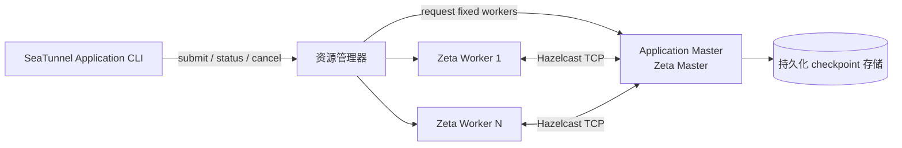

# Application Mode

Application Mode 为每个作业运行一套独立的 Zeta 集群：资源平台启动专用的 Master 和固定数量的
Worker，Master 只运行一个作业，作业结束后平台回收全部进程。Worker 注册、slot 调度、任务执行和
checkpoint 仍由 Zeta 自己负责，平台只提供并回收计算资源。



## 集群形态

- 一个 application 运行一个 Zeta Master 和固定数量的 Worker，作业运行期间不增删成员；
- Worker 在作业启动前把 slot 注册到 Master；
- Master 把作业结果映射为平台终态，并在退出前释放全部 Worker；
- checkpoint 存放在引擎侧的持久化存储中，可跨 application 生命周期，由新的 application 按 job ID 恢复。

## 命令行

```bash
bin/seatunnel-application.sh submit -t <target> -c job.conf -a application.config
bin/seatunnel-application.sh status -t <target> --id APPLICATION_ID -a application.config --wait
bin/seatunnel-application.sh cancel -t <target> --id APPLICATION_ID -a application.config
```

| 参数 | 含义 |
| --- | --- |
| `-t`, `--target` | 运行 application 的资源平台 |
| `-c`, `--config` | SeaTunnel 作业配置文件，submit 必填 |
| `-a`, `--application-config` | 可选部署文件，包含公共选项和平台选项 |
| `--wait` | submit/status 等待终态；不传则立即返回 |
| `-ikey=value` | 非敏感部署覆盖项，例如 worker 资源或平台选项 |

`submit` 在平台接受 application 后立即返回，不等待 Master，所以镜像拉取慢或平台调度慢不会让提交失败。
`status`、`cancel` 只访问平台 API，Master 退出后仍可使用。

## 前提条件

- 发行版中包含所选用资源平台的 provider；
- 平台能够启动、观测并在 application 结束时回收专用进程；
- 凭据不要写进作业文件：通过平台管理的 Secret 注入，并在 application 中用 `${VAR}` 占位符解析。

平台相关的环境准备、权限和配置说明见对应平台指南。
