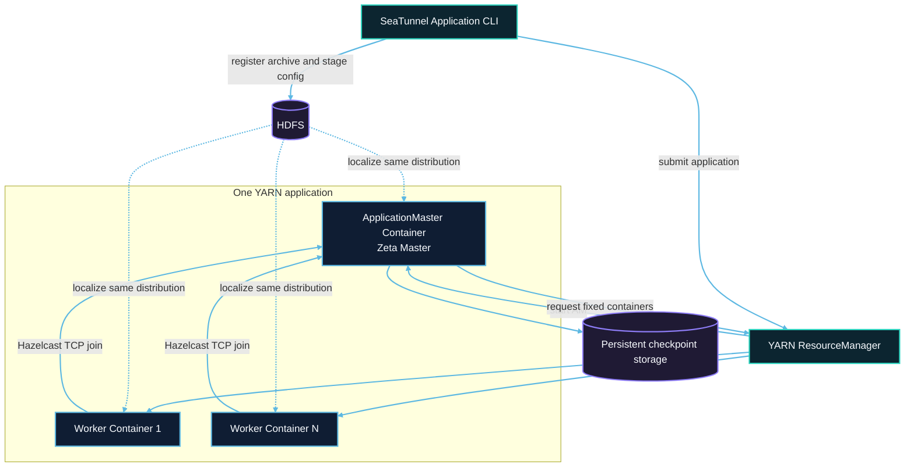

# YARN 集群架构

每次提交创建一个 YARN application。提交客户端只负责准备和上传文件；ApplicationMaster 接管之后的 Master、Worker 和作业生命周期。



## 提交流程

1. 客户端从 ResourceManager 获取 application ID。
2. 客户端创建权限为 `0700` 的 staging 目录，保存配置文件和发行包清单。对于 staging 所在 HDFS 的具名快照，直接校验快照中的归档。其他归档先复制到 staging 再校验。清单记录 AM 和 worker 共用的归档 URL、大小和修改时间。
3. 客户端状态监视器等待 ResourceManager 启动 ApplicationMaster 或报告终态；NodeManager 本地化并解压同一发行包。
4. ApplicationMaster 启动独立 Zeta Master，通过 `AMRMClientAsync` 注册并申请固定数量的 Worker Container。
5. `NMClient` 在 Container 中启动 Worker JVM。每个已分配 Container 作为一个 Worker 节点跟踪；Worker 使用 Master 的实际地址加入独立 Hazelcast 集群。
6. 所有 Worker 完成成员和 slot 注册后，Master 提交唯一的 Zeta 作业。
7. 作业进入终态后，Master 释放 Worker、注销 YARN application 并清理 staging。

## 身份与资源本地化

在 simple 认证集群中，容器使用配置的 Hadoop 用户。安全集群中，提交端使用已有票据或 keytab 登录，获取 staging 文件系统的 delegation token 并放入 AM 的启动上下文。AM 启动 worker 时转交 HDFS token。

AM 和 worker 工厂分别声明各自的装配顺序，使用 `YarnContainerSpec` 封装 Hadoop 的 `ContainerLaunchContext`。提交端先上传 AM 各步骤通过 `build()` 声明的文件，再按同一顺序调用 `decorate(spec)` 构建启动上下文。只有 AM 的步骤包含私有作业配置。AM 启动第一个 worker 时读取所需文件的大小和时间戳，后续 worker 复用这份元数据，每次启动单独获取凭据。

NodeManager 为每个容器解压相同的 `ARCHIVE`。AM 还会收到应用部署描述和指定的作业文件，包括从内联内容生成的文件。分发的配置文件和合并后的 Hadoop XML 对两个角色都可见。每个 worker 在自己的本地化发行包内定位所需 JAR。

提交端轮询 ResourceManager 的应用报告，等待 AM 就绪。在 AM 内，Hadoop 负责发送分配心跳，并把 worker 事件交给已注册的回调。`onContainersAllocated` 通过 NodeManager 启动 worker。`onContainersCompleted` 将异常退出的容器 ID、退出码和诊断信息通知引擎。如果 ResourceManager 要求 AM 关闭，driver 会通知引擎并停止接受新的 worker 请求。

将 `YarnResourceManagerCallbackHandler` 的日志级别设为 DEBUG，可以看到容器资源调整和 NodeManager 状态变化。Worker 沿用启动时配置的 slot 数。节点进入退役流程后，已有容器可以继续运行，直到 YARN 报告容器结束。

### Worker 事件与就绪状态

分配成功的容器会获得 YARN container ID。只有 worker JVM 加入 AM 并完成注册后，Zeta 才能使用它的 slot。排查作业等待时，可以结合 application attempt、container 报告和 worker 日志，判断当前在等调度还是等注册。

## 网络与容量

YARN Container 使用宿主机网络。NodeManager 之间必须允许 Master Hazelcast 端口和 Worker 端口通信。`application.master.port` 是 Master 起始端口；发生冲突时会选择后续可用端口，并把实际地址传给 Worker。

ResourceManager 的应用报告会公开 Master 的 Hazelcast 地址。默认配置使用应用专属集群名，原生客户端和集群成员连接时无需身份认证。Kerberos 认证仅覆盖 Hadoop 服务。在共享集群上，应启用 YARN ACL，限制可查看应用报告的用户。同时应限制候选 NodeManager 上 Hazelcast 端口的网络访问，只允许受信任的应用容器和获得授权的 SeaTunnel 客户端连接。隔离范围应包含同机的其他工作负载。无法隔离租户时，请使用专用节点或受信任的集群。

Master 不提供 task slot。总固定容量为：

```text
application.worker-count × application.worker.slots
```

资源请求还必须满足队列配额、ResourceManager 最大 Container 能力和 NodeManager 可用容量。

设置 `yarn.master.http-port` 后，AM 会另外绑定一个用于 HTTP 或 HTTPS 的固定端口，并向 ResourceManager 注册承载 AM 的 NodeManager 主机和网页地址。worker 使用 Hazelcast 端口。直连页面的客户端和 YARN Web Proxy 需要能够访问 AM 的 Web 服务端口。

## Staging 与 checkpoint

Staging 只服务于一次 application，结束后会被删除。checkpoint 必须配置在 staging 目录之外。可以使用 HDFS 暂存发行包，同时使用 HDFS、OSS、S3 或 COS 保存 checkpoint。

ApplicationMaster 或 Worker 丢失会使当前 application 失败。恢复会创建新的 application，不会重新加入旧 Hazelcast 集群。详见 [Checkpoint 恢复](checkpoint-recovery.md)。
