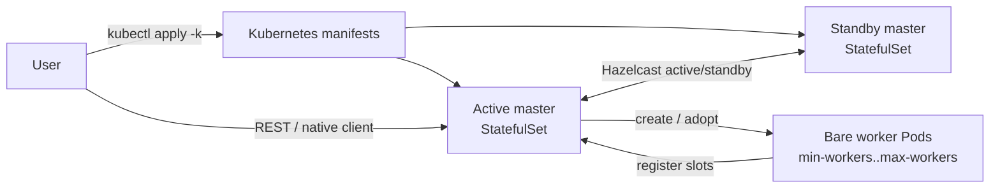

# Session 集群

Session 集群是一个长期存活的 Zeta 集群，多个 job 共享同一组 master 和 worker。两个 master
组成 Hazelcast active/standby；active master 创建 worker，job 通过 REST 或原生客户端提交。

[Application Mode](../application/overview.md) 不同：它为一个 job 创建专属的 master 和 worker。

## 拓扑



Master 使用 2 副本 StatefulSet；Worker 是由 root ConfigMap 拥有的 bare Pod。Slot 固定，
扩容上限为 `max-workers`，不支持缩容。

## 部署

请先阅读 [Kubernetes 部署](../kubernetes/kubernetes.mdx) 和
[Kubernetes 配置](../kubernetes/configuration.md)。Session 镜像必须包含
`seatunnel-session-cluster.sh` 和 Kubernetes resource-manager provider。

```bash
kubectl apply -k deploy/kubernetes/session
```

示例将 master/worker 配置都放在 `conf/`。Kustomize 生成一个 `<session-name>-config` ConfigMap；
master 挂载整个 ConfigMap，worker 挂载自己需要的 key。

同 namespace 运行另一个 Session 时，复制目录并修改所有 Session 作用域内的资源名、标签、
`session.yaml`、`configMapGenerator` 名称以及 Hazelcast/client DNS：

```bash
cp -R deploy/kubernetes/session /tmp/payments-session
# 按上面的说明修改 /tmp/payments-session。
kubectl apply -k /tmp/payments-session
```

## 配置

`conf/session.yaml` 是 Session 配置。未知字段会被忽略；非法值会导致 master 启动失败。

```yaml
session:
  name: seatunnel-session-cluster
  cluster-name: seatunnel-session-cluster
  root-config-map: seatunnel-session-cluster-meta

  master:
    port: 5801

  worker:
    image: apache/seatunnel:3.0.1
    min-workers: 2
    max-workers: 32
    slots: 8
    cpu-cores: 2
    memory-mb: 4096
    heap-mb: 3072
    jvm-options: "-Xms3g -Xmx3g"
    image-pull-policy: IfNotPresent
    service-account: default
    seatunnel-home: /opt/seatunnel
    config-map: seatunnel-session-cluster-config

    # 可选。值是字面量或 secret:name/key、configmap:name/key。
    # env:
    #   AWS_REGION: us-east-1
    # env-from:
    #   secret: s3-credentials
    #   configmap: shared-settings
    # secret-ref: session-secret
    # secret-directory: /etc/seatunnel-secrets/session

  dynamic-worker:
    enabled: true
    startup-timeout-millis: 120000
    retry-interval-millis: 3000

kubernetes:
  namespace: seatunnel
```

:::caution 固定 slot

`session.worker.slots` 必须等于 worker `seatunnel.yaml` 的 `slot-service.slot-num`；
`session.worker.config-map` 必须包含 `seatunnel.yaml`、`hazelcast-worker.yaml`、
`log4j2.properties`、`jvm_worker_options`。

:::

:::tip Session 标识

`session.name` 是 DNS-1123 label，最长 40 个字符；同 namespace 多个 Session 时必须唯一。
`session.root-config-map` 必须已存在且有 server-assigned UID。

:::

`min-workers` 默认 `2`，`max-workers` 默认 `32`，`dynamic-worker.enabled` 默认 `false`。
master/worker 的 engine 和 Hazelcast 配置请参考
[分离集群模式](../kubernetes/separated-cluster-mode.md)；示例的 `file:///tmp/` 存储仅用于本地验证。

## 启动

```bash
kubectl apply -k deploy/kubernetes/session
kubectl -n seatunnel get pods -w
```

状态、日志和 REST 访问请参考 [Kubernetes 运维](../kubernetes/operations.md)。

## 提交 job

REST：

```bash
kubectl -n seatunnel port-forward svc/seatunnel-session-cluster-rest 8080:8080
curl -X POST http://127.0.0.1:8080/submit-job \
  -H 'Content-Type: application/json' \
  -d @job.json
```

原生客户端：

```bash
/opt/seatunnel/bin/seatunnel.sh --config job.conf -m cluster
```

客户端配置指向
`seatunnel-session-cluster-client.seatunnel.svc.cluster.local:5801`。

## 扩容

active master 启动时创建 `min-workers`。pending job slot 不足时，按
`ceil(missingSlots / slotsPerWorker)` 创建 Worker，上限为 `max-workers`，等待注册后重试分配。
`REJECT` 在超时后失败，`WAIT` 继续等待。

## 停止

先删 master StatefulSet，再删 Session 资源。namespace 有多个 Session 时不要使用
`kubectl delete -k`。

```bash
SESSION_NAME=seatunnel-session-cluster

kubectl -n seatunnel delete statefulset "${SESSION_NAME}-master"
kubectl -n seatunnel delete configmap "${SESSION_NAME}-meta" "${SESSION_NAME}-config"
kubectl -n seatunnel delete service \
  "${SESSION_NAME}-headless" "${SESSION_NAME}-rest" "${SESSION_NAME}-client"
kubectl -n seatunnel delete pdb "${SESSION_NAME}-master"
```

用户自有的 checkpoint、PVC、被引用的 ConfigMap/Secret 不会被删除。

## 实验性限制

- Worker 模板不支持原地修改；修改配置需要新建 Session。
- 不支持自动缩容和手动 scale/spec API。
- 除 Hazelcast active/standby 和 StatefulSet 重建外，没有额外 HA 编排。
- 不支持多租户配额、Kerberos 或 CPU 感知 slot 调度。
