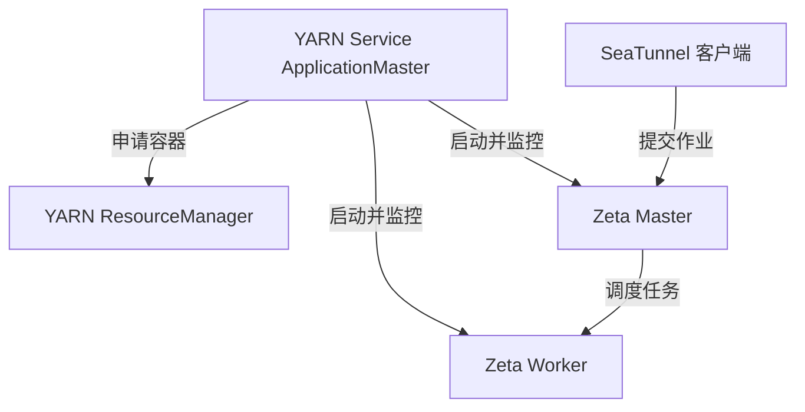

<!--
Licensed to the Apache Software Foundation (ASF) under one or more
contributor license agreements.  See the NOTICE file distributed with
this work for additional information regarding copyright ownership.
The ASF licenses this file to You under the Apache License, Version 2.0
(the "License"); you may not use this file except in compliance with
the License.  You may obtain a copy of the License at

    http://www.apache.org/licenses/LICENSE-2.0

Unless required by applicable law or agreed to in writing, software
distributed under the License is distributed on an "AS IS" BASIS,
WITHOUT WARRANTIES OR CONDITIONS OF ANY KIND, either express or implied.
See the License for the specific language governing permissions and
limitations under the License.
-->

# YARN 部署

通过 Hadoop YARN Service，可以让多个作业共用一套常驻的 SeaTunnel Zeta 集群。服务的 ApplicationMaster 向 YARN 申请容器并启动 Zeta Master 和 Worker。客户端把作业提交给 Zeta Master，由 Master 将任务调度给 Worker。一个作业结束后，服务保留容器，可以继续接收作业。

## 集群拓扑

示例在两个容器中分别启动一个 Master 和一个 Worker。单 Master 没有备用节点。需要高可用时，请在不同主机上部署至少两个 Master，并按实际拓扑配置成员发现地址和 IMap 备份副本数。[分离集群部署](../../engines/zeta/separated-cluster-deployment.md)

## 前置条件

- 准备已启用 HDFS 和 YARN Service 的 Hadoop 集群。示例使用 Hadoop 3.3.6，ResourceManager 需要启用 `yarn.webapp.api-service.enable=true`。提交用户需要能写入 HDFS 上的发行包和 checkpoint 目录，目标队列应有足够资源同时运行 ApplicationMaster、Master 和 Worker。[Hadoop YARN Service 快速入门](https://hadoop.apache.org/docs/r3.3.6/hadoop-yarn/hadoop-yarn-site/yarn-service/QuickStart.html)
- 为 Master 准备一个客户端和容器都能解析的稳定主机名，并确保它们能访问 Zeta 成员。示例使用 YARN Registry DNS。[YARN 服务发现](https://hadoop.apache.org/docs/r3.3.6/hadoop-yarn/hadoop-yarn-site/yarn-service/ServiceDiscovery.html)
- 在提交机上解压 SeaTunnel 二进制发行包，把 `SEATUNNEL_HOME` 指向解压目录。提交机和容器里都需要能运行 Java 11 或 17。示例使用 SeaTunnel 3.1.0 及 FakeSource、Console 连接器。

## 部署和运维

- [分离集群模式](separated-cluster-mode.md)介绍如何上传发行包、启动服务并提交第一个作业。
- [YARN 配置](configuration.md)列出打包前需要修改的发行包配置。
- [YARN 运维](operations.md)介绍如何检查集群状态、调整 Worker 数量、查看日志和重启服务。
